# Data Plane — Songbird (eBPF)

| | |
|---|---|
| Version | 3.1-draft |
| Status | Draft for team review |
| Supersedes | `dataplane.md` v2 (Italian, exploratory, RGFM-style identifiers) |
| Inputs | Requirements Analysis v2.0.1-draft, Domain Model v0.4-draft, Component View v0.1-draft, `reconciliation.md` |
| Decisions | [ADR-0002](adr/0002-forwarding-model.md) … [ADR-0007](adr/0007-reference-platform.md) |

This document describes the internal design of the **Data Plane**: the eBPF programs and maps that parse, filter, track, translate and forward packets. The Control Plane side (compiling the configuration into maps, applying it, collecting events) is described in `components.md`; the objects being enforced are defined in `domain-model.md`; how and when maps are applied is in `reconciliation.md`.

## Requirements covered

| Area | Requirements |
|---|---|
| Forwarding | R-001, R-001.1, R-001.2 |
| NAT | R-002, R-003 |
| Policies | R-014, R-014.1–R-014.4, R-033, R-046 (Zones) |
| Stateful filtering | R-045, R-045.1, R-045.2 (proposed) |
| Apply and lifecycle | R-020.6, R-033.1, R-036, R-036.1, R-054 (proposed) |
| Events | R-026, R-026.1 |
| Security | R-039 (enforcement), R-053 (proposed) |
| Performance | R-047, R-048, R-049 (proposed, targets to be agreed) |
| Constraint | C-001 |
| **Deferred** (IPv6) | R-001.3, R-001.4, R-005, R-006, R-006.1, R-006.2 |

## Changes since v2

- **3.1**: Zone selection replaced by RuleSet selection (domain model v0.5).
- Identifiers aligned with RA v2 (`R-NNN`, `C-NNN`); document translated to English.
- **RuleSets** (domain model v0.5): the classifier first selects the RuleSet that governs the Interface pair, then classifies only among its Policies. Five match dimensions become four, and bitmaps are per RuleSet. Zones (sets of Interfaces) are expanded by the Compiler and do not exist in the Data Plane.
- **IPv6 is deferred**: an explicit interim policy drops IPv6 instead of passing it (§5).
- New **local-in** path for traffic addressed to the firewall itself (`allowAccess`, active services) and **local-out** path for traffic the firewall originates (§6).
- **Virtual IP matching**: a DNAT'ed packet matches only Policies that reference its VIP (§7.4).
- Each map generation carries the **commit id** it was compiled from, so the Control Plane knows what is applied after a restart (§8).
- Events carry `policy_gen`, so the matched Policy can be named even after reordering (§11).
- The six open questions of v2 are now ADR-0002 … ADR-0007.

## 1. Scope

**The Data Plane does**: parse packets; enforce Policies, Default Deny and administrative access; track Flows; apply DNAT and SNAT; emit Flow Events and counters.

**It does not**: read YAML, know object names, run DHCP or DNS, route (the kernel does, see §3), persist anything.

**Contract with the Control Plane** (owned by the Dataplane Driver, see `components.md`):

| Direction | Mechanism |
|---|---|
| Configuration down | Generational maps (§8), filled from the Compiler's `Plan` |
| Topology down | Interface maps: logical Interface ids, local addresses, egress addresses for masquerade (§4, §6) |
| Events up | Ring buffer (§11) |
| Counters up | Per-CPU arrays read by the Observer (§11) |
| Applied state up | Generation header (§8) |

## 2. Limits of the PoC (`PoC-basic-xdp-firewall`)

| Problem | Effect | Addressed in |
|---|---|---|
| Linear scan of 256 rules with `#pragma unroll` | O(N) per packet, hard limit of 256 rules, very large program for the verifier | §7 |
| No connection tracking | Replies need explicit rules; the filter is not stateful | §9 |
| IPv4 only, header assumed 20 bytes | IPv6 always passes; IPv4 options (IHL>5) give wrong ports | §4, §5 |
| No 802.1Q parsing | Tagged traffic passes unfiltered | §4 |
| IPv4 fragments not handled | Non-initial fragments have random "ports" | §4, ADR-0005 |
| `bpf_perf_event_output` per packet | Event channel saturates the CPU under flood | §11 |
| Everything that is not IPv4 gets `XDP_PASS` | Unfiltered bypass | §5 |
| Rule update element by element | A packet can see half old and half new policy (violates R-020.6) | §8 |
| `main_test.go` uses non-existent `RuleKey`/`RuleValue` | The test does not compile | §13 |

## 3. Forwarding model

Decided in [ADR-0002](adr/0002-forwarding-model.md): **XDP decides, the kernel forwards, TC rewrites.**

The key technical constraint: a packet redirected with `XDP_REDIRECT` **does not traverse the TC egress hook** of the egress device (it goes to the driver via `ndo_xdp_xmit`). "XDP on ingress + TC for NAT" therefore works only if forwarding is done by the kernel stack.

- **XDP** (ingress, physical NIC): parsing, prefilter, connection tracking, Policy decision → `XDP_DROP` or `XDP_PASS`.
- **Kernel**: routing (static routes installed by the Network Driver via netlink), ARP, MTU and ICMP errors, local sockets.
- **TC** (ingress and egress, any netdevice including VLAN and `ppp0`): DNAT, reverse SNAT, SNAT, local-out tracking.

A fast path with `XDP_REDIRECT` for established Flows without NAT between physical NICs is deferred until the benchmark shows it is needed (R-047).

The kernel's own netfilter rule engines are not used (C-001). The Network Driver sets the required sysctls (`ip_forward`, `rp_filter`, …).

## 4. Pipeline

```mermaid
flowchart LR
    NIC[Physical NIC] --> P

    subgraph XDP["XDP ingress (physical NIC)"]
        P["Parse L2/L3/L4<br/>VLAN, PPPoE, IPv4, fragments"] --> V6{IPv6?}
        V6 -- yes --> D6["XDP_DROP<br/>ipv6-unsupported"]
        V6 -- no --> CTL{"ARP or DHCP<br/>to firewall?"}
        CTL -- yes --> PASS
        CTL -- no --> PF["Prefilter<br/>threat-intel blocklist"]
        PF --> RN["Reverse NAT lookup<br/>real tuple, no rewrite"]
        RN --> CT{CT lookup}
        CT -- "established / related" --> PASS["XDP_PASS + metadata"]
        CT -- new --> DN{"DNAT lookup<br/>ingress if, proto, addr, port"}
        DN -- hit --> FIB
        DN -- miss --> LOC{"Destination is a<br/>firewall address?"}
        LOC -- yes --> LI["Local-in check<br/>allowAccess, active services"]
        LI -- allow --> NEWL[Create CT] --> PASS
        LI -- deny --> DROP
        LOC -- no --> FIB["bpf_fib_lookup<br/>post-DNAT destination"]
        FIB --> Z{"RuleSet lookup<br/>in if, out if"}
        Z -- none --> DROP["XDP_DROP + event"]
        Z -- found --> POL["Classifier<br/>per-RuleSet bitmaps"]
        POL -- accept --> NEW[Create CT] --> PASS
        POL -- "drop / default deny" --> DROP
    end

    PASS --> TCI["TC ingress<br/>DNAT, reverse SNAT"]
    TCI --> K["Kernel stack<br/>routing, ARP, local sockets"]
    K --> TCE["TC egress<br/>SNAT masquerade,<br/>local-out CT entry"]
    TCE --> OUT["Egress Interface<br/>also VLAN / ppp0"]
```



XDP passes its decision (Flow id, NAT flags, VIP id) to TC through **XDP metadata** (`bpf_xdp_adjust_meta` → `skb->data_meta`), so TC does not repeat the lookups.

The DNAT lookup comes **before** the local-address check because a Virtual IP's external address is usually an address of the firewall (DM-19): a packet to `WAN-IP:80` with a VIP is translated, not delivered locally.

## 5. Parsing

- **VLAN**: XDP is attached to the **physical Interface**; VLAN sub-interfaces support only generic XDP. Up to two tags are read (802.1Q / 802.1ad). With `rxvlan` offload active the NIC strips the tag: disable it (`ethtool -K <if> rxvlan off`) or read it with the kfunc `bpf_xdp_metadata_rx_vlan_tag` (kernel ≥ 6.8, driver-dependent).
- **Logical Interfaces**: map `{physical ifindex, vlan id} → logical Interface id`, maintained by the Network Driver. All later lookups use the logical id.
- **PPPoE** (WAN on FTTH): session frames (ethertype `0x8864`) are parsed to the inner IPv4 header, and `{physical ifindex, session id} → logical id` (`ppp0`). Whether XDP metadata reaches TC on `ppp0` is **not verified**; the fallback is to classify PPPoE traffic in TC ingress on `ppp0` (see §15, ADR-0007).
- **IPv4**: header length from `ihl * 4`. Non-initial fragments follow [ADR-0005](adr/0005-ipv4-fragments.md): dropped and counted when forwarded; passed to the kernel for reassembly, rate-limited, when addressed to the firewall itself.
- **IPv6 (interim)**: the Ethertype is recognised and the packet is **dropped and counted** with reason `ipv6-unsupported`. It is never passed, because passing would forward it unfiltered. When IPv6 is designed, this rule is replaced by the full parser (extension headers, NDP exceptions required by R-005).
- **Always allowed before any Policy**: ARP; DHCP requests (UDP 67) on Interfaces where the DHCP server is active.
- **Address representation**: one 128-bit format; IPv4 mapped as `::ffff:a.b.c.d`. Kept although IPv6 is deferred, so that adding IPv6 does not change the layout of keys.

## 6. Traffic classes

| Class | Definition | Decided by |
|---|---|---|
| **Forwarded** | Enters an Interface, leaves another | RuleSet + Policies (§7), Default Deny |
| **Local-in** | Addressed to an address of the firewall, not matched by a VIP | `allowAccess` and active services of the ingress Interface |
| **Local-out** | Originated by the firewall (DNS upstream queries, Git push, ACME, alerting) | Always allowed; tracked so that replies are accepted |
| **Control** | ARP, DHCP to the firewall | Always allowed (§5) |

### 6.1 Local-in

The Compiler produces, per logical Interface:

```c
struct local_in_cfg {
    __u8  allow_ping;        // allowAccess contains ping
    __u8  allow_https;       // allowAccess contains https
    __u8  dhcp_active;       // DHCP server enabled on this Interface
    __u8  dns_active;        // DNS service listening on this Interface
};
```

The configuration used is the one of the **Interface that owns the targeted address** (FortiGate semantics), found through `local_addrs`, not the one of the Interface the packet arrives on. A new local-in Flow is accepted if, for that owner Interface:

1. ICMP echo request and `allow_ping`;
2. TCP to the management port (443) and `allow_https`;
3. UDP 67 and `dhcp_active`, or UDP/TCP 53 and `dns_active` (domain-model constraint DM-34);

otherwise it is dropped with reason `local-in-deny` and a rate-limited event. Replies to local-out Flows are matched earlier by the CT lookup.

Example: with `https` allowed on LAN and not on WAN, a LAN client reaches the UI on the LAN address but not on the WAN address. A packet that arrives on one Interface and targets the address of another is judged by the owner's configuration; see the safeguard in §15.

`local_addrs` is a hash `{address} → owner Interface`, maintained by the Network Driver.

### 6.2 Local-out

XDP sees only ingress, so locally originated Flows must be tracked on egress. The TC egress program, on a packet with no CT entry and a local source address, creates a CT entry pair with flag `LOCAL_OUT` and no Policy evaluation. The reply arriving on the WAN then matches the CT in XDP. Without this, the DNS forwarder, GitOps Sync, ACME and Alerting would see their replies dropped by Default Deny.

SNAT is not applied to local-out Flows: their source is already an Interface address.

## 7. Policy classifier

### 7.1 RuleSet selection

```
ruleset_id = rulesets[{in_logical_if, out_logical_if}]
```

The output Interface comes from `bpf_fib_lookup` on the **post-DNAT** destination. No entry → Default Deny (reason `no-ruleset`).

Zones do not exist in the Data Plane: the Compiler expands each RuleSet into one entry per pair of member Interfaces (a RuleSet from a 2-Interface Zone to a 3-Interface Zone gives 6 entries). DM-07, DM-37 and DM-38 guarantee that every pair maps to at most one RuleSet, so this is a single exact-match lookup with no `any`. Pairs of members of the same Zone with no RuleSet get an entry only if `intraZoneTraffic: allow` (DM-39), pointing to a built-in accept-all RuleSet.

### 7.2 Bit-vector classification within the RuleSet

Same approach as Polycube / pcn-iptables, now per RuleSet:

1. The Compiler orders the RuleSet's enabled Policies (disabled ones are omitted): **Policy index within the RuleSet = bit position**.
2. For each dimension, one lookup returns a **bitmap** of the Policies compatible with that field.
3. `match = src & dst & svc` (with `MAX_RULES_PER_RULESET = 1024`, 16 `u64` words; value in [ADR-0006](adr/0006-capacity-limits.md)).
4. The **first set bit** is the first matching Policy (R-014.4). BPF has no `ctz`: implemented with 6 shift steps or a de Bruijn table.
5. No bit set → **Default Deny** (R-033).

| Dimension | BPF structure | Precomputation (Go) |
|---|---|---|
| Source / destination | `LPM_TRIE`, key `{prefixlen, ruleset_id, addr[16]}` → bitmap. The `ruleset_id` is part of the prefix, so one trie serves all RuleSets | LPM returns only the longest prefix, so each prefix's bitmap also contains the Policies of the prefixes that include it. Address `all` is the IPv4 entry `::ffff:0:0/96`. Ranges are decomposed into CIDRs; groups are the union of their members; InterfaceAddresses is resolved to the Interface's subnets |
| Destination via VIP | `ARRAY[vip_id]` → bitmap (per RuleSet) | See §7.4 |
| Service | `ARRAY[65536]` per protocol (TCP, UDP) → `u16 port_class`, then `ARRAY[ruleset][class]` → bitmap | Equivalence classes computed over **all** Policies, so the 64 K arrays are shared by every RuleSet; ICMP uses the same technique on `type`; `any` sets the bit for every class |

Cost per **new** Flow: about 5 lookups and an AND on 16 words, independent of the number of Policies up to the per-RuleSet limit. Established Flows skip the classifier (§9).

### 7.3 Address types not supported in the Data Plane

| Type | Why | Status |
|---|---|---|
| `fqdn` | Needs DNS resolution and map updates whenever the answer changes | Requires a Control Plane resolver feeding the LPM; **not designed** (§15) |
| `mac` | Needs an L2 dimension; meaningful only on a directly connected segment | **Not designed** (§15) |

Until designed, the Validator should reject them in Policies.

### 7.4 Virtual IP matching

A packet translated by VIP `k` matches **only** the Policies whose destinations include VIP `k`; a non-translated packet matches only the non-VIP destinations:

```
dst_bits = dnat_hit ? vip_bits[ruleset][k] : lpm_dst(ruleset, daddr)
```

Without this rule, a Policy with destination `all` would also accept DNAT'ed traffic, and a Policy referencing the VIP's mapped address would accept traffic that reached the internal server without going through the VIP. The Service dimension is evaluated on the **post-DNAT** port (§15).

## 8. Atomic update and applied state

Configuration maps are `ARRAY_OF_MAPS` / `HASH_OF_MAPS` with **two generations**; a global variable `active_gen` selects the one in use. The Dataplane Driver builds the inactive generation, verifies it, then switches `active_gen` with a single write. The program reads `active_gen` once per packet, so it always sees a coherent configuration. Rollback switches back (R-020.6).

**Generational** (configuration): RuleSet selection, classifier maps, VIP/DNAT, local-in configuration, egress addresses, blocklist.
**Not generational** (state): CT, SNAT reverse table, counters, ring buffer.

Each generation carries a header:

```c
struct gen_header {
    __u32 gen;            // monotonically increasing
    __u32 plan_version;   // layout version of the compiled plan
    __u8  commit_id[32];  // Git commit compiled into this generation (SHA-1 zero-padded or SHA-256)
    __u64 applied_ns;
};
```

After a Control Plane restart the Dataplane Driver reads the active header and reports the applied commit to the Reconciler, which compares it with `HEAD` and applies only if they differ (R-033.1).

## 9. Connection tracking

Decided in [ADR-0003](adr/0003-own-conntrack.md): **own conntrack in BPF maps**, no `nf_conntrack`.

```c
struct ct_key {               // 40 bytes
    __u8  saddr[16], daddr[16];
    __be16 sport, dport;      // ICMP: id + type
    __u8  proto, pad[3];
};

struct ct_entry {             // 96 bytes
    __u64 last_seen_ns;
    __u64 packets, bytes;     // per direction
    __u32 policy_gen;         // generation that accepted the Flow
    __u16 rule_idx;           // Policy index within the RuleSet
    __u16 ruleset_id;
    __u16 flags;              // DIR_REPLY, SEEN_REPLY, SNAT, DNAT, LOCAL_IN, LOCAL_OUT
    __u8  tcp_state;          // SYN_SENT, SYN_RECV, ESTABLISHED, FIN_WAIT, CLOSE
    __u8  pad;
    __u16 vip_id;
    __be16 nat_port;
    __u8  nat_addr[16];       // translated address applied in TC
    struct ct_key peer;       // key of the other direction
};
```

- `LRU_HASH` with **two entries per Flow** (ORIG and REPLY): a reply is found with a direct lookup, without normalising the tuple. `peer` allows re-classification and deletion of both entries from either direction.
- **Stateful** (R-045): a reply is accepted by CT state without re-evaluating Policies.
- **RELATED** (R-045.1): for ICMP errors (dest-unreachable, frag-needed, time-exceeded) the embedded header is read and the inverted tuple is looked up. Without it Path MTU Discovery breaks.
- **Timeouts** (R-045.2, configurable): TCP handshake 30 s, established 3600 s, closing 10 s; UDP 60 s (180 s bidirectional); ICMP 30 s.
- **Expiry**: lazy check at lookup (`now - last_seen > timeout` → new Flow) plus a periodic sweep in the Dataplane Driver, which also emits `FLOW_END` with counters.
- **SYN flood protection**: entries in `SYN_SENT` live in a **separate, smaller map**; the Flow moves to the main map at the first reply. A SYN proxy in XDP can be added later.
- **Policy change** ([ADR-0004](adr/0004-active-flows-on-policy-change.md), R-054): at the next packet of a Flow whose `policy_gen` differs from the active generation, the ORIG tuple is re-classified. If it is still accepted, `policy_gen` and `rule_idx` are updated; otherwise the packet is dropped, both entries are deleted and `FLOW_END` is emitted with reason `policy-change`. Local-in Flows are re-checked against the new local-in configuration the same way.

## 10. NAT (TC)

General rule: **XDP reads, TC writes.** XDP consults the NAT maps to know the real tuple and decide; every packet rewrite happens in TC, where `bpf_l3_csum_replace` / `bpf_l4_csum_replace` also handle checksum offload correctly.

| Function | Hook | Mechanism |
|---|---|---|
| **DNAT** via Virtual IP (R-003) | Lookup in XDP, rewrite in TC ingress | `dnat HASH {ingress logical if, proto, daddr, dport} → {vip_id, mapped addr, mapped port}`. Port ranges are expanded into one entry per port, up to the limit in ADR-0006; a range external→single mapped port maps all to the same port (DM-20) |
| **SNAT / masquerade** (R-002) | TC egress of the output Interface | Applied when the matched Policy has `nat.mode = interface` (flag stored in CT). Source = primary address of the output Interface (`egress_addr` map). First packet: random port in a range (e.g. 32768–60999) inserted with `BPF_NOEXIST` into `snat_rev`, at most N attempts (same scheme as Cilium). Port space exhausted → drop + counter + event `nat-exhausted` |
| **Reverse SNAT** | Lookup in XDP, rewrite in TC ingress | `snat_rev {post-SNAT tuple} → original tuple` |
| **NAT with IpPool** | — | Not designed (domain model allows it; RA has no requirement yet) |
| **NAT64** | — | Deferred with IPv6 |

## 11. Events and counters

- `BPF_MAP_TYPE_RINGBUF` (size in ADR-0006) instead of the perf buffer.
- Events are **per Flow, not per packet** (R-026):

```c
struct flow_event {
    __u64 ts_ns;
    __u8  saddr[16], daddr[16];
    __be16 sport, dport;
    __u8  proto;
    __u8  type;          // FLOW_NEW, FLOW_DROP (from XDP); FLOW_END (from the sweep)
    __u8  verdict;       // accept, drop
    __u8  reason;        // see below
    __u32 in_if;         // logical Interface id
    __u16 ruleset_id;
    __u16 rule_idx;
    __u32 policy_gen;    // with ruleset_id and rule_idx, identifies the Policy
    __u64 packets, bytes;// FLOW_END only
};
```

- **Matched Policy identifier**: the Event Collector translates `(policy_gen, ruleset_id, rule_idx)` into `(RuleSet name, Policy name)` using the name table of that generation. The Control Plane keeps the tables of the current and the previous generations long enough for in-flight events.
- **Reasons**: `policy`, `default-deny`, `no-ruleset`, `local-in`, `local-in-deny`, `blocklist`, `malformed`, `fragment`, `ipv6-unsupported`, `nat-exhausted`, `policy-change`.
- **Rate limiting** (R-026.1): token bucket per CPU for drop events; drops are always counted; if `bpf_ringbuf_reserve` fails, `events_lost` is incremented.
- **Counters**: `PERCPU_ARRAY` per Policy (packets, bytes, hits) and per drop reason. They feed `/health`, `/metrics` and the charts (R-032, R-051).
- **Pseudonymisation** (R-037) is applied in Go by the Event Collector before writing to disk, not in BPF.

## 12. Lifecycle and robustness

- **Pinned maps and links** in `/sys/fs/bpf/songbird/`. If the Control Plane crashes, the Data Plane keeps enforcing the last configuration; at restart the Dataplane Driver reattaches to the pinned objects and reads the generation header (§8). bpffs is in memory, so after a reboot everything is rebuilt from `HEAD` (after schema migration, ADR-0008).
- **Hot reload** (R-036, R-036.1): `link.Update()` on the XDP/TCX `bpf_link` replaces the program atomically, without detach or packet loss. Maps with unchanged layout are reused. If `ct_key` / `ct_entry` change, a migration is needed: the layout is versioned through `plan_version`.
- **Attachment**: the Dataplane Driver attaches XDP to every physical Interface present at startup and to new ones on netlink events, so no physical Interface bypasses the filter.
- **Toolchain**: current `cilium/ebpf` with `bpf2go`, which generates the Go structs from C and removes hand-written structs and endianness conversions. TC attach with **TCX** (`link.AttachTCX`, kernel ≥ 6.6). The kernel version of the target OS must be verified (ADR-0007).
- **Embedding**: the eBPF objects are embedded in the single Go binary (`go:embed`), consistent with C-004 and with an image that ships only that binary.

## 13. Testing

- **Unit** (`T-U`): `BPF_PROG_TEST_RUN` (`prog.Run()`) with packets built in Go (gopacket): verdict, rewrites, events. No NIC needed, only `CAP_BPF`/root.
- **Equivalence** (`T-U`, R-014.4): fuzzing that compares the eBPF classifier with a reference classifier in Go on random configurations and packets.
- **Integration** (`T-I`): network namespaces with veth (client – songbird – server): stateful TCP/UDP, PMTUD, DNAT, SNAT, local-in, local-out, policy change.
- **Performance** (`T-P`): `pktgen` / TRex on the reference platform (ADR-0007) for R-047, R-048, R-049.

## 14. Incremental plan

| Phase | Content | Verification |
|---|---|---|
| 0 | Project structure: `bpf2go`, current `cilium/ebpf`, `PROG_TEST_RUN` harness; fix the PoC test | Tests compile and run in CI |
| 1 | Parser: VLAN, IPv4 with IHL, fragments (ADR-0005), interim IPv6 drop, ARP/DHCP exceptions | Malformed and boundary packet suite |
| 2 | RuleSet lookup, per-RuleSet bitmap classifier, Go compiler "Plan → maps", generation swap with header | Equivalence fuzzing against the Go reference classifier |
| 3 | Conntrack (TCP/UDP/ICMP, RELATED, timeouts, sweep, ring-buffer events), local-in, local-out, policy change | netns: stateful TCP/UDP, PMTUD, UI reachable only where allowed, DNS forwarder works |
| 4 | DNAT with VIP matching, SNAT masquerade in TC | netns: port forwarding and masquerade towards a simulated Internet |
| 5 | PPPoE path; benchmark; fast path XDP only if needed | Benchmark against R-047 |
| later | IPv6, NDP, NAT64, `fqdn` and `mac` Addresses, IpPool | — |

## 15. Open questions

1. **Cross-interface access to local addresses**: with the owner rule, a packet arriving on the WAN but addressed to the LAN address of the firewall is accepted if the LAN allows `https`. On the Internet such a packet is rarely routable, but an on-link attacker (the upstream router) can send it. Proposed safeguard: accept a local-in Flow only if the ingress Interface owns the address, or if the ingress Interface is not `role: wan`. To be decided.
2. **Management port**: fixed 443, or configurable? If a VIP uses the same external address and port while `https` is allowed on that Interface, one of them must win: proposed DM-35 rejects the collision.
3. **Service on DNAT'ed traffic**: matched on the post-DNAT port (current design) or on the original port?
4. **`fqdn` and `mac` Addresses**: design them, or remove them from the first release?
5. **DNAT port ranges**: is expansion with a cap acceptable, or is a range structure needed?
6. **XDP metadata support** on the reference NIC drivers, and whether it survives to TC on VLAN and `ppp0` devices.
7. **Local-out detection** in TC egress: confirm the technique (no CT entry + local source address) against edge cases such as forwarded packets with spoofed local sources, which XDP must have dropped first.
8. **Performance of the forwarding model**: the stack forwards about 1–2 Mpps per core, close to the R-047 target of 1 Mpps per core with 1 000 Policies. To be measured before ADR-0002 is accepted.

## 16. Impact on other documents

| Document | Change |
|---|---|
| Domain model | DM-34 (active services open their ports on the Interface), DM-35 (VIP must not collide with the management port), DM-36 (per-RuleSet Policy limit) |
| RA | Interim IPv6 behaviour (drop, counted) while R-001.3/R-001.4 are deferred; requirement for administrative access per Interface; Default Deny also for traffic with no RuleSet |
| components.md | Dataplane Driver owns the CT sweep (emits `FLOW_END`) and reports the applied commit from the generation header |
