# Songbird – Data plane eBPF v2 (design esplorativo)

> Stato: **bozza per discussione**. Sostituisce il modello del `PoC-basic-xdp-firewall`.
> Requisiti principali coperti: RGFM1, RGFM2, RGFM3, RGFM5, RGFM6, RGFM10–14, RGFM16, RGFM26, RGFM33, RGFS20.7, RGFS33.1, RGFN36, RGFM39.

## 1. Limiti del PoC attuale

| Problema | Effetto |
|---|---|
| Scansione lineare di 256 regole con `#pragma unroll` | Costo O(N) per **ogni** pacchetto, limite rigido a 256 regole, programma enorme per il verifier |
| Nessun conntrack | Le risposte (es. SYN-ACK in ingresso) vanno ammesse con regole esplicite, quindi il firewall non è stateful |
| Solo IPv4, `iph` assunto di 20 byte | IPv6 passa sempre (`XDP_PASS`), opzioni IPv4 (IHL>5) leggono porte errate |
| Nessun parsing VLAN 802.1Q | Il traffico taggato passa senza filtro |
| Frammenti IPv4 non gestiti | I frammenti non iniziali hanno "porte" casuali |
| `bpf_perf_event_output` per ogni pacchetto | Sotto flood il canale eventi satura la CPU; RGFM26 chiede ring buffer |
| Tutto ciò che non è IPv4 riceve `XDP_PASS` | ARP/NDP funzionano solo perché IPv6 non viene filtrato; quando si filtra IPv6, NDP va ammesso esplicitamente (RGFM5) |
| Aggiornamento regole elemento per elemento | Durante il sync il pacchetto può vedere metà vecchia e metà nuova policy (viola RGFS20.7) |
| `main_test.go` usa `RuleKey`/`RuleValue` inesistenti | Il test non compila |

## 2. La decisione chiave: chi fa il forwarding

Vincolo tecnico da tenere presente: **un pacchetto rediretto con `XDP_REDIRECT` non passa dall'hook TC egress** del device di uscita (va direttamente al driver tramite `ndo_xdp_xmit`). Quindi "XDP in ingresso + TC per il NAT" funziona **solo se il forwarding lo fa lo stack del kernel** (o un redirect da TC), non un redirect XDP.

| Opzione | Descrizione | Pro | Contro |
|---|---|---|---|
| **A. XDP decide, kernel instrada, TC riscrive** | XDP: parsing, prefiltro, policy, conntrack → `XDP_DROP`/`XDP_PASS`. Kernel: routing statico (FIB via netlink), ARP/NDP, MTU/ICMP. TC: DNAT/SNAT/NAT64 | Semplice, robusto, funziona anche su VLAN/PPPoE/WireGuard; drop a velocità XDP | Il forwarding accettato va alla velocità dello stack (~1–2 Mpps/core) |
| B. Tutto in XDP | XDP fa anche NAT, `bpf_fib_lookup` e `XDP_REDIRECT` (devmap) | Prestazioni massime | Reimplementare NAT, checksum, MTU, ICMP error, push del tag VLAN; non funziona su `ppp0`/VLAN device; TC serve comunque per il traffico locale |
| C. TC-centrico (modello Cilium) | XDP solo prefiltro; policy, CT e NAT in TC con `bpf_redirect_neigh` | Un solo punto con `skb` (helper checksum, `bpf_skb_change_proto`) | Si perde il vantaggio di XDP sul drop delle policy |

**Raccomandazione: opzione A come base, con un fast path XDP opzionale (B) per i flussi established senza NAT tra NIC fisiche, in una fase successiva.**

Motivo pratico per Songbird: una WAN in PPPoE (comune su FTTH) o una VLAN non supporta XDP nativo, mentre TC funziona su qualunque netdevice. Il NAT verso la WAN deve quindi stare in TC.

## 3. Pipeline

```mermaid
flowchart LR
    NIC[NIC fisica] --> XDP

    subgraph XDP["XDP ingress (NIC fisica)"]
        P[Parse L2/L3/L4<br/>VLAN, v4/v6, ext hdr, frag] --> PF[Prefiltro<br/>blocklist LPM, bogon]
        PF --> RN[Lookup NAT inverso<br/>tuple reale, senza riscrivere]
        RN --> CT{CT lookup}
        CT -- established/related --> OK[XDP_PASS + metadata]
        CT -- new --> DN[Lookup DNAT<br/>dst post-DNAT]
        DN --> FIB[bpf_fib_lookup<br/>→ interfaccia/zona uscita]
        FIB --> POL[Classificatore policy<br/>bitmap]
        POL -- accept --> NEW[Crea CT] --> OK
        POL -- drop / default deny --> DROP[XDP_DROP + evento]
    end

    OK --> TCI[TC ingress<br/>riscrittura DNAT / reverse SNAT / NAT64]
    TCI --> K[Stack kernel<br/>routing, ARP/NDP, servizi locali]
    K --> TCE[TC egress<br/>SNAT masquerade, allocazione porte]
    TCE --> OUT[Interfaccia uscita<br/>anche VLAN / ppp0]
```



XDP passa la decisione (id flusso, flag NAT) a TC tramite **metadata XDP** (`bpf_xdp_adjust_meta` → `skb->data_meta`). In questo modo TC non ripete i lookup.

## 4. Parsing

- **VLAN**: XDP va agganciato all'**interfaccia fisica**. Le sub-interfacce VLAN supportano solo XDP generico. Bisogna leggere fino a 2 tag (802.1Q / 802.1ad). Con l'offload `rxvlan` attivo il tag viene rimosso dalla NIC e non è visibile nel pacchetto: va disattivato (`ethtool -K <if> rxvlan off`) oppure letto con il kfunc `bpf_xdp_metadata_rx_vlan_tag` (kernel ≥ 6.8, dipende dal driver).
- **Interfaccia logica**: map `{ifindex fisico, vlan_id} → ifindex logico`, mantenuta dal control plane via netlink.
- **IPv4**: usare `ihl*4`. Frammenti: il primo frammento viene valutato; i non iniziali si associano al primo tramite una map `frag {saddr, daddr, id, proto} → verdetto` (LRU, TTL breve). Alternativa più semplice: drop dei frammenti non iniziali senza stato, come scelta di policy.
- **IPv6**: ciclo limitato (es. 6 iterazioni) sugli extension header (Hop-by-Hop, Routing, Fragment, Dest Options). AH ed ESP terminano il parsing L4.
- **Sempre ammessi (prima della policy)**: ARP, ICMPv6 NDP/RS/RA (tipi 133–137) con hop limit 255, e i DHCP/DHCPv6 diretti al firewall se il servizio è attivo. Senza questa eccezione la default deny (RGFM33) rompe IPv6 (RGFM5) e SLAAC (RGFM4).
- **Indirizzi**: un'unica rappresentazione a 128 bit; IPv4 mappato come `::ffff:a.b.c.d`. Policy, CT e NAT usano un solo formato di chiave e NAT64 (RGFM6) diventa una semplice traduzione tra famiglie.

## 5. Classificatore di policy (lookup LPM/hash)

Le regole RGFM14 hanno 5 dimensioni: zona/interfaccia di ingresso, zona/interfaccia di uscita, sorgente, destinazione, servizio. Una singola chiave hash non basta, perché wildcard, CIDR e gruppi si combinano tra loro. Lo schema proposto è la **classificazione a bit-vector**, lo stesso approccio di Polycube/pcn-iptables:

1. Le regole vengono ordinate per priorità in Go: **indice di regola = posizione del bit**.
2. Per ogni dimensione, un lookup O(1) o O(log) restituisce una **bitmap** delle regole compatibili con quel campo.
3. `match = in_zone & out_zone & src & dst & svc` (con `MAX_RULES=1024` sono 16 parole u64).
4. La **prima regola che corrisponde è il primo bit a 1**. BPF non ha un'istruzione `ctz`: si implementa con 6 passi di shift o con una tabella de Bruijn.
5. Se non c'è nessun bit a 1 si applica la **default deny** (RGFM33).

| Dimensione | Struttura BPF | Note di precalcolo (Go) |
|---|---|---|
| Sorgente / destinazione | `LPM_TRIE` chiave `{prefixlen, addr[16]}` → bitmap | La LPM restituisce **solo** il prefisso più lungo, quindi la bitmap di ogni prefisso deve contenere anche le regole dei prefissi che lo includono. C'è sempre una voce `::/0` con le regole "any". I range (RGFM12) vengono scomposti in CIDR. Un gruppo (RGFM13) è l'unione dei suoi elementi |
| Servizio | `ARRAY[65536]` per protocollo (TCP/UDP) → `u16 port_class`, poi `ARRAY[class]` → bitmap | Classi di equivalenza: le porte che compaiono nello stesso insieme di regole condividono la classe. Occupa circa 128 KB per protocollo e supporta range e Service Group (RGFM10/11). ICMP usa la stessa tecnica su `type` |
| Zona in / out | `HASH ifindex logico → zone_id`, `ARRAY[zone]` → bitmap | La zona di uscita si ricava da `bpf_fib_lookup` sulla destinazione **post-DNAT** |

Costo per pacchetto **nuovo**: circa 6 lookup più un AND su 16 parole, **indipendente dal numero di regole** fino a `MAX_RULES`. I pacchetti dei flussi established non passano dal classificatore (§6).

### Aggiornamento atomico (RGFS20.7)
Le map dei dati sono `ARRAY_OF_MAPS` / `HASH_OF_MAPS` con **2 generazioni**, e una variabile globale `active_gen` indica quella in uso. Go costruisce la generazione inattiva, la verifica e poi cambia `active_gen` con una sola scrittura. Il programma legge `active_gen` una volta per pacchetto, quindi vede sempre una policy coerente. Il rollback consiste nel tornare alla generazione precedente.

## 6. Conntrack

### Implementazione propria o kfunc del kernel?

| | **CT proprio in map BPF** (modello Cilium) | kfunc netfilter (`bpf_xdp_ct_lookup`, `bpf_ct_insert_entry`, `bpf_ct_set_nat_info`) |
|---|---|---|
| Dipendenze | Nessuna | `nf_conntrack`: zona grigia rispetto a RGFM16 ("bypass iptables/nftables") |
| Prestazioni | Lookup hash diretto | Overhead più alto, allocazione nel kernel |
| TCP window tracking, ALG (FTP/SIP) | Da implementare (in forma semplificata) | Già disponibili |
| Sync HA (RGFC23) | Da implementare in Go | `conntrackd` già esistente |
| Controllo e osservabilità | Totale | Tramite `conntrack -L`, ma la semantica è del kernel |

**Raccomandazione: CT proprio.** È coerente con RGFM16 e prevedibile nelle prestazioni. L'HA è "Could" e si può risolvere in seguito.

### Strutture

```c
struct ct_key {               // 40 byte
    __u8  saddr[16], daddr[16];
    __be16 sport, dport;      // per ICMP: id + type
    __u8  proto, pad[3];
};

struct ct_entry {
    __u64 last_seen_ns;
    __u64 packets, bytes;     // per direzione: due entry
    __u32 rule_id, policy_gen;
    __u16 flags;              // DIR_REPLY, SEEN_REPLY, NAT_SNAT, NAT_DNAT, LOG
    __u8  tcp_state;          // SYN_SENT, SYN_RECV, ESTABLISHED, FIN_WAIT, CLOSE
    __u8  zone_in, zone_out;
    __u8  nat_addr[16];       // indirizzo tradotto da applicare in TC
    __be16 nat_port;
};
```

- Map `LRU_HASH` con **due entry per flusso** (ORIG e REPLY). Il pacchetto di ritorno viene trovato con un lookup diretto, senza normalizzare la tupla.
- Il **pacchetto di ritorno è accettato dallo stato** del CT, senza rivalutare la policy: è questo che rende il firewall stateful.
- **RELATED**: per gli ICMP/ICMPv6 di errore (dest-unreachable, packet-too-big, time-exceeded) si legge l'header interno e si cerca la tupla invertita nel CT. Senza questo si rompe il Path MTU Discovery.
- **Timeout** (configurabili): SYN 30 s, TCP established 3600 s, FIN/RST 10 s, UDP 60 s (180 s se bidirezionale), ICMP 30 s.
- **Scadenza**: controllo pigro durante il lookup (`now - last_seen > timeout` → flusso nuovo) più uno sweep periodico in Go, che emette anche l'evento di chiusura sessione con i contatori.
- **Protezione da SYN flood**: una LRU unica permetterebbe a un SYN flood di espellere i flussi established. Le entry in `SYN_SENT` vanno quindi in una **map separata più piccola**; il flusso passa a `ct_main` solo alla prima risposta. In seguito si può aggiungere un SYN-proxy XDP (vedi `xdp_synproxy` nei sample del kernel).
- **Cambio policy**: ogni entry registra `policy_gen`. Quando cambia la policy, i flussi con generazione vecchia vengono rivalutati al pacchetto successivo (re-classify) e chiusi se non più ammessi. Il comportamento va deciso (§10).

## 7. NAT (TC)

Regola generale: **XDP legge, TC scrive**. XDP consulta le map NAT per conoscere la tupla "reale" e decidere; tutte le riscritture dei pacchetti avvengono in TC, dove `bpf_l3_csum_replace`/`bpf_l4_csum_replace` gestiscono correttamente anche il checksum offload.

| Funzione | Hook | Meccanismo |
|---|---|---|
| **DNAT / port forwarding** (RGFM3) | TC ingress | `dnat_rules HASH {proto, daddr, dport} → {new_addr, new_port}`. La policy viene valutata sulla **destinazione post-DNAT**, come fanno FortiGate (VIP) e nftables |
| **SNAT / masquerade** (RGFM2) | TC egress dell'interfaccia di uscita | All'arrivo del primo pacchetto: porta casuale nel range (es. 32768–60999) e inserimento con `BPF_NOEXIST` in `snat_rev` con al massimo N tentativi (stesso schema di Cilium). Se lo spazio porte è esaurito → drop + contatore + evento |
| **Reverse SNAT** | Lookup in XDP, riscrittura in TC ingress | `snat_rev {tupla post-SNAT} → tupla originale` |
| **NAT64** (RGFM6/7/8) | TC | `bpf_skb_change_proto()` (v6↔v4), prefisso configurabile in una variabile globale (default `64:ff9b::/96`). DNS64 (RGFM18.6) resta nel control plane |

## 8. Eventi e osservabilità (RGFM26, RGFS27.4, RGNM27.6)

- `BPF_MAP_TYPE_RINGBUF` (es. 4–16 MB) al posto del perf buffer.
- Eventi **per flusso, non per pacchetto**: `FLOW_NEW` (accept, con regola), `FLOW_DROP`, `FLOW_END` (dallo sweep in Go, con byte e pacchetti). In questo modo sono rispettati sia RGFM26 sia il carico.
- **Rate limit dei drop** (token bucket per CPU o per regola): sotto DDoS non si genera un evento per ogni pacchetto scartato. I drop vengono comunque contati, e se `bpf_ringbuf_reserve` fallisce si incrementa un contatore `events_lost`.
- Contatori `PERCPU_ARRAY` per regola (pacchetti/byte/hit) e per motivo di drop (malformato, blocklist, default deny, NAT esaurito…). Alimentano `/health` (RGFS32) e i grafici.
- La pseudonimizzazione degli IP (RGFN37) avviene in Go prima della scrittura su disco, non in BPF.

## 9. Ciclo di vita, robustezza e test

- **Map e link pinnati** in `/sys/fs/bpf/songbird/`. Se il processo Go va in crash il data plane continua a filtrare con l'ultima policy; al riavvio Go si ricollega alle map pinnate (RGFS33.1). Su Hadron bpffs è in memoria, quindi dopo un reboot si riparte dallo YAML.
- **Hot reload** (RGFN36): `link.Update()` sul `bpf_link` XDP/TCX sostituisce il programma in modo atomico, senza detach e senza perdita di pacchetti. Le map con schema invariato vengono riusate. Se il layout di `ct_key`/`ct_entry` cambia serve una migrazione: le struct devono avere un campo versione.
- **Toolchain**: aggiornare `cilium/ebpf` (oggi alla 0.11) e usare `bpf2go`, che genera le struct Go dal C e rende superflue le struct e le conversioni di endianness scritte a mano. Attach TC con **TCX** (`link.AttachTCX`, kernel ≥ 6.6). La versione del kernel di Hadron va verificata.
- **Test**:
  - unit test con `BPF_PROG_TEST_RUN` (`prog.Run()`): pacchetti costruiti in Go (gopacket) e verifica di verdetto e riscritture. Non serve una NIC, servono solo CAP_BPF/root;
  - test di integrazione con netns + veth (client – songbird – server), DNAT/SNAT verificati con traffico reale;
  - benchmark con `pktgen`/TRex per i target di prestazione, che vanno ancora aggiunti ai requisiti.

## 10. Piano incrementale

| Fase | Contenuto | Verifica |
|---|---|---|
| 0 | Struttura del progetto: `bpf2go`, `cilium/ebpf` aggiornato, harness `PROG_TEST_RUN` | Test che compilano e girano in CI |
| 1 | Parser completo (VLAN, v4 con IHL, v6 con ext header, frammenti, eccezioni NDP/ARP) | Suite di pacchetti malformati e ai limiti |
| 2 | Classificatore bitmap + compilatore Go "regole YAML → map" + swap di generazione | Test di equivalenza con un classificatore di riferimento in Go (fuzzing) |
| 3 | Conntrack (TCP/UDP/ICMP, RELATED, timeout, sweep, eventi ringbuf) | netns: TCP/UDP stateful, PMTUD |
| 4 | DNAT + SNAT in TC | netns: port forwarding e masquerade verso "Internet" simulata |
| 5 | NAT64 e fast path XDP per i flussi established (opzione B) | Benchmark |

## 11. Domande aperte

1. **Forwarding**: si accetta l'opzione A (forwarding via stack kernel) per la prima release, oppure esiste un target di throughput che richiede subito il fast path XDP?
2. **Conntrack proprio o nf_conntrack**: RGFM16 esclude anche `nf_conntrack` o solo iptables/nftables?
3. **Cambio policy**: le sessioni attive che una nuova policy non permette più vanno chiuse subito (comportamento FortiGate di default) o lasciate scadere?
4. **Frammenti IPv4**: tracking o drop dei frammenti non iniziali?
5. **Limiti**: valori obiettivo per `MAX_RULES` (1024? 4096?), numero di sessioni concorrenti (es. 1M = circa 200 MB di CT) e pps.
6. **Hardware di riferimento**: driver NIC con XDP nativo (i40e/ice/mlx5/ixgbe) e uso di PPPoE sulla WAN.
