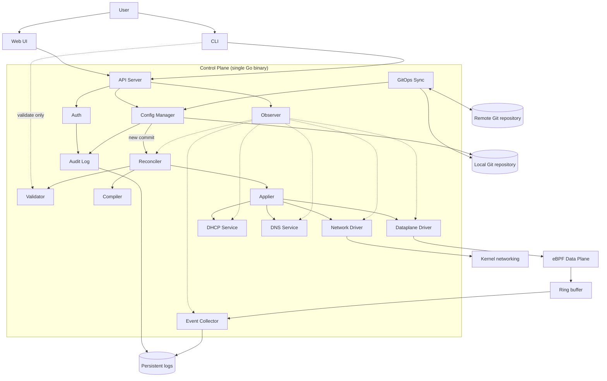
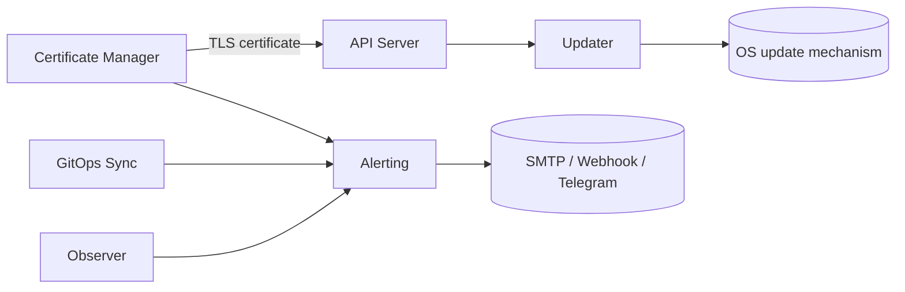

# Component View — Songbird

| | |
|---|---|
| Version | 0.2-draft |
| Inputs | Requirements Analysis v2.0.3-draft, Domain Model v0.7-draft, `dataplane.md`; the loop itself is detailed in `reconciliation.md` |
| Scope | Components, responsibilities, interfaces, dependency rules, requirement traceability |
| Not covered here | Deployment on Hadron (separate `deployment.md`), internal design of the eBPF Data Plane (`dataplane.md`) |

This view is **deployment-agnostic**: it does not depend on how the product is distributed (Hadron image upgraded in place, or a custom ISO using Hadron as a base with separate configuration). The only component sensitive to that choice is the [Updater](#updater), which hides it behind the `UpdateBackend` interface.

## Design principles

1. **One binary, many modules.** The Control Plane is a single Go binary (C-004). Each component below is a Go package with an explicit interface; none is a separate process, except the Data Plane, which lives in the kernel.
2. **Git is the source of truth** (C-005). Components read the desired state from the Config Manager, never from the running system.
3. **One-way pipeline.** `commit → validate → compile → apply → observe`. The API never touches the running system directly.
4. **Pure functions where possible.** Validator and Compiler have no side effects and no I/O, so they are fully testable with `T-U` without a kernel.
5. **One owner per concern.** Every requirement of the RA is assigned to exactly one responsible component (see the [matrix](#requirement-matrix)).

## Overview

### Core pipeline

Dotted arrows are reads of status. Solid arrows are calls.

### Supporting components

## Components

"Phase" is indicative and will be fixed by the Project Plan: **0.1** = needed for the first usable release, **later** = afterwards.

| Component | Responsibility (one sentence) | Does **not** | Offers | Uses | Phase |
|---|---|---|---|---|---|
| **Web UI** | Lets an administrator view and edit configuration and status in a browser. | Hold state or talk to anything but the API. | — (browser UI) | REST API | 0.1 |
| **CLI** | Provides command-line access, including `songbird validate <dir>`. | Apply configuration to a running system. | `songbird` commands | REST API; Validator (for `validate`) | 0.1 |
| **API Server** | Exposes the HTTPS API, authenticates requests and turns edits into commits. | Call drivers or the Data Plane; hold configuration. | REST API | Auth, Config Manager, Validator (pre-check), Observer, Updater | 0.1 |
| **Auth** | Owns Users, Roles, sessions, TOTP and login lockout. | Decide what a Role may do on a given resource (the API does, from the Role's permissions). | `Authenticate`, `Authorize`, session tokens | Config Manager (Users/Roles are configuration), Audit Log | 0.1 |
| **Config Manager** | Reads and writes the desired state in the local Git repository (one commit per saved change), creates the factory-default configuration on first boot, and encrypts secrets at rest. | Validate semantics, apply anything, talk to the remote. | `ConfigStore` | Git repository, Audit Log | 0.1 |
| **Validator** | Checks a configuration tree against the schema and the domain-model constraints (`DM-xx`). | Perform I/O or change anything. | `Validator` | Domain-model types | 0.1 |
| **Compiler** | Turns a validated configuration into a desired-state plan per subsystem. | Perform I/O or change anything. | `Compiler` | Domain-model types; runtime facts passed in (e.g. current interface addresses) | 0.1 |
| **Reconciler** | Decides **when** to apply (new commit, boot, retry) and tracks desired vs applied state. | Know how a subsystem is configured; apply anything itself. | `ReconcilerStatus`, `Trigger` | Config Manager, Validator, Compiler, Applier | 0.1 |
| **Applier** | Executes **one** apply as a transaction across all drivers: all commit, or all roll back. | Decide when to apply; know subsystem details. | `Applier` | `Driver` implementations | 0.1 |
| **Dataplane Driver** | Loads the eBPF programs, fills the maps with the compiled plan and swaps generations atomically. | Process packets; classify traffic. | `Driver` | Data Plane (maps, programs) | 0.1 |
| **Network Driver** | Applies interfaces, VLANs, addresses and static routes to the kernel. | Forward packets; run DHCP or DNS. | `Driver` | Kernel (netlink) | 0.1 |
| **DHCP Service** | Serves DHCPv4 leases and reservations per Interface. | Choose its own configuration. | `Driver`, `StatusProvider` | DHCP engine (in-process or external, [ADR-0014](../../adr/0014-dhcp-and-dns-engines.md)) | 0.1 |
| **DNS Service** | Resolves, forwards and caches DNS on the Interfaces in its `listenOn`; fails over between upstreams; resolves FQDN Addresses for the Compiler (R-012.2). | Choose its own configuration. | `Driver`, `StatusProvider` | DNS engine (in-process or external, [ADR-0014](../../adr/0014-dhcp-and-dns-engines.md)) | 0.1 |
| **Data Plane (eBPF)** | Filters, tracks Flows, translates addresses and forwards packets in the kernel. | Know about YAML, Git or users. | Maps and programs; ring-buffer events | — | 0.1 |
| **Event Collector** | Reads Flow Events from the ring buffer, masks addresses and persists them with rotation. | Decide whether traffic is allowed. | `EventSource` consumers; log files; event stream for the UI | Data Plane ring buffer, Config Manager (masking policy) | 0.1 |
| **Observer** | Computes and exposes health, status and metrics of every subsystem. | Change state. | `/health`, `/metrics`, `StatusProvider` aggregate | Reconciler, drivers, services, Event Collector | 0.1 |
| **Audit Log** | Records administrative actions in an append-only, hash-chained log. | Decide what is audited (sources call it). | `AuditSink`, verification | Persistent storage | 0.1 |
| **GitOps Sync** | Pushes and pulls the local repository to and from the remote and surfaces conflicts. | Edit configuration directly; merge silently. | Push/pull/diff operations | Local repository, remote repository, Alerting | later |
| **Alerting** | Delivers notifications for alert conditions, independently of the UI. | Detect conditions (sources raise them). | `Alerting.Raise` | SMTP, webhook, Telegram | later |
| **Certificate Manager** | Obtains and renews TLS certificates via ACME. | Serve HTTPS. | Current certificate for the API Server | ACME server, Alerting | later |
| **Updater** | Triggers an OS and application update with rollback on failure. | Know how the update is delivered. | `Updater` (via API) | `UpdateBackend` | later |

### Future components (placeholders, not designed yet)

| Component | Requirements |
|---|---|
| HA Manager (VRRP, node coordination) | R-023, R-023.1–R-023.5 |
| Routing Daemon integration (BGP) | R-024 |
| IDS/IPS integration | R-025 |
| Threat-Intelligence Feed (list download, refresh) | R-039.1, R-039.2 (enforcement is in the Data Plane) |

## Interfaces

Informal contracts. Signatures belong to the Detailed Design.

| Interface | Provided by | Used by | Operations (informal) |
|---|---|---|---|
| **REST API** | API Server | Web UI, CLI | CRUD of configuration objects; status; login and session; update trigger. Every route requires authentication except login and `/health` (R-043). |
| **ConfigStore** | Config Manager | API, Reconciler, GitOps Sync | `Read(rev)` returns the configuration tree; `Commit(changes, author, message)` returns the commit id; `History`; `Revert(rev)`; `Subscribe` to new commits. |
| **Validator** | Validator | Reconciler, API, CLI | `Validate(tree)` returns a list of errors, each with file, path and reason (R-020.3). |
| **Compiler** | Compiler | Reconciler | `Compile(tree, runtimeFacts)` returns a `Plan` with one section per subsystem (dataplane, network, DHCP, DNS). Deterministic. |
| **Applier** | Applier | Reconciler | `Apply(plan)` returns *applied* or *rolled back with reason*. |
| **Driver** | Dataplane Driver, Network Driver, DHCP Service, DNS Service | Applier | `Snapshot()` of current state; `Prepare(section)` validates and stages with no visible effect; `Commit()`; `Rollback()`. |
| **ReconcilerStatus** | Reconciler | Observer, API | Desired commit, applied commit, state (*starting, reconciling, in-sync, failed, degraded*), last error, per-driver status. See `reconciliation.md` §9. |
| **StatusProvider** | Drivers, services, Event Collector | Observer | `Status()` returns *running / degraded / stopped* plus details (R-032). |
| **AuditSink** | Audit Log | Config Manager, Auth, API | `Record(actor, action, before, after, source address)`. |
| **Alerting** | Alerting | Observer, GitOps Sync, Certificate Manager | `Raise(condition, severity, details)`. |
| **EventSource** | Data Plane | Event Collector | Ring buffer with `FLOW_NEW`, `FLOW_DROP`, `FLOW_END` (R-026); an `events_lost` counter (R-026.1). Format in `dataplane.md`. |
| **Dataplane control** | Data Plane | Dataplane Driver | eBPF programs and maps, two generations with atomic swap. Contract in `dataplane.md`. |
| **UpdateBackend** | OS-specific adapter | Updater | `Available()`, `Stage(version)`, `Activate()` (reboot), `Rollback()`. One implementation per distribution mechanism. |
| **TLS certificate** | Certificate Manager | API Server | Current certificate and key; notification on renewal. |

## Dependency rules

These rules are what makes the component view checkable. They should be enforced in CI (e.g. Go `internal` packages and an import linter).

1. Web UI and CLI depend only on the REST API. The single exception is `songbird validate`, which links the Validator directly so it runs without an appliance.
2. The API Server never calls drivers, services or the Data Plane. It **writes** through the Config Manager and **reads** status through the Observer.
3. Validator and Compiler are pure: no I/O, no clock, no global state.
4. Only the Applier calls `Driver.Commit`. Only the Reconciler calls the Applier.
5. Drivers do not know each other and do not know Git, YAML or the domain-model objects: they receive their section of the `Plan`.
6. Dependencies form a DAG with this order: clients → API → (Auth, Config Manager, Observer) → Reconciler → (Validator, Compiler, Applier) → drivers → kernel. Nothing points upward.
7. Configuration is always read from the Config Manager, never reconstructed from the running system.

## Key design choices

- **Validation happens twice.** The API validates a proposed change before committing it (fast feedback, no invalid commit), and the Reconciler validates `HEAD` before every apply (the repository can also change through a pull or a manual edit). This is a candidate ADR.
- **Reconciler vs Applier.** The Reconciler is a control loop (*when*, retries, boot behaviour); the Applier is a transaction (*how*, all-or-nothing). They are separable because the Applier can be tested with fake drivers, while the Reconciler can be tested with a fake Applier.
- **Crash recovery comes for free** (R-033.1): at boot the Reconciler reads `HEAD` and applies it, with the API not needed at all.
- **No bootstrap mode.** On first boot the Config Manager commits a factory-default configuration (for example one Interface with a known address and `https` in `allowAccess`). The Reconciler applies it like any other commit, and the setup wizard is an ordinary UI flow that edits it (R-031, R-031.1).
- **Schema migration** runs in the Config Manager at startup, before the Reconciler reads the configuration. See ADR-0008.
- **Rollback is a new commit** that reverts to a previous revision, which is then applied by the normal pipeline. There is no second mechanism.
- **Administrative access (`allowAccess`) and System Services** are part of the compiled `Plan` and are enforced by the Data Plane's local-in path, because C-001 excludes nftables. `allowAccess` opens Management Services on an Interface; a System Service (DNS, NTP) opens its own ports on the Interfaces in its `listenOn` (DM-34).
- **Overlapping RuleSets are flattened by the Compiler.** A member Interface may be used next to its Zone; the Compiler builds, for each ordered pair of Interfaces, one effective Policy list in the evaluation order of DM-42, so the Data Plane still does a single lookup per pair. The same order is returned by the API and the CLI to show it to the user (R-046.3).
- **Audit and Git pulls.** The Config Manager records every change, so changes arriving through GitOps Sync are audited as well as those from the UI.

## Requirement matrix

Every requirement has exactly one **responsible** component, which carries the verification. **Contributes** lists the other components involved. Items marked *(deferred)* depend on IPv6, which is out of the current domain model.

### Routing and translation

| Requirement | Responsible | Contributes |
|---|---|---|
| R-001, R-001.1, R-001.2 | Data Plane | Network Driver (interfaces, routes) |
| R-001.3, R-001.4 *(deferred)* | Data Plane | Network Driver |
| R-001.5 | Network Driver (routes with distance and priority) | Observer (link state) |
| R-057 | Data Plane (interim IPv6 drop) | — |
| R-002, R-002.1, R-002.2 | Data Plane | Compiler |
| R-003 | Data Plane | Compiler (DNAT candidates) |
| R-004 *(deferred)* | Network Driver | — |
| R-005 *(deferred)* | Data Plane | — |
| R-006, R-006.1, R-006.2 *(deferred)* | Data Plane | Compiler |

### Configuration objects and Policies

| Requirement | Responsible | Contributes |
|---|---|---|
| R-009, R-009.1, R-009.2 | Web UI | API Server, Compiler (omits disabled Policies) |
| R-010, R-011, R-012, R-013, R-012.4, R-012.5 | Validator | Compiler |
| R-010.1, R-012.1 | Config Manager (predefined Service `any`, Addresses `any`, `any6`) | Validator |
| R-012.2 | Compiler (FQDN sets as runtime facts) | DNS Service (resolution), Data Plane |
| R-012.3 | Data Plane (source MAC match) | Validator (source only) |
| R-014 | Validator | — |
| R-014.1, R-014.2, R-014.3 | Compiler (expands groups and lists into match rules) | Data Plane |
| R-014.4 | Data Plane (first match wins) | Compiler (preserves order) |
| R-015, R-015.1 | Web UI | Observer (interface events) |
| R-014.5, R-046 | Validator | Compiler (expands Zones) |
| R-046.1 | Compiler (effective Policy list per Interface pair) | Data Plane |
| R-046.2 | Compiler | Data Plane |
| R-046.3 | Web UI | CLI, API Server, Compiler (evaluation order) |

### Network services

| Requirement | Responsible | Contributes |
|---|---|---|
| R-017, R-017.1, R-017.2, R-017.3 | DHCP Service | Compiler |
| R-017.4 *(deferred)* | DHCP Service | — |
| R-018, R-018.1–R-018.5 | DNS Service | Compiler |
| R-018.6 *(deferred)* | DNS Service | — |
| R-034, R-034.1 | DNS Service | — |
| R-058 | Data Plane (local-in) | Compiler, DNS Service |

### Configuration, GitOps and lifecycle

| Requirement | Responsible | Contributes |
|---|---|---|
| R-019 | Updater | Reconciler (config after update) |
| R-020, R-020.1 | Config Manager | Validator |
| R-021.5 | Config Manager (optimistic locking) | API Server |
| R-020.2, R-020.3, R-020.4 | Validator | Web UI (shows errors) |
| R-020.5 | Config Manager | — |
| R-020.6 | Applier | Drivers, Reconciler |
| R-021 | Config Manager | API Server |
| R-021.1, R-021.2, R-021.3, R-021.4 | GitOps Sync | Alerting (R-021.2) |
| R-031 | Web UI (setup wizard) | API Server |
| R-031.1 | Config Manager (factory-default configuration) | Data Plane (enforces `allowAccess`), Compiler |
| R-033 | Data Plane | — |
| R-033.1 | Reconciler | Config Manager |
| R-036, R-036.1 | Dataplane Driver | Data Plane |
| R-040, R-041, R-042 | Web UI | API Server, GitOps Sync |
| R-052 (`songbird validate`) | CLI | Validator |

### Future components

| Requirement | Responsible |
|---|---|
| R-023, R-023.1–R-023.5 | HA Manager |
| R-024 | Routing Daemon integration |
| R-025 | IDS/IPS integration |
| R-039, R-039.1, R-039.2 | Threat-Intelligence Feed (enforcement by the Data Plane) |

### Observability and logging

| Requirement | Responsible | Contributes |
|---|---|---|
| R-026 | Data Plane | — |
| R-026.1 | Data Plane (rate limiting) | Event Collector (counts lost events) |
| R-027, R-027.1, R-027.2, R-027.3 | Web UI | Observer |
| R-028, R-028.1 | Web UI | Event Collector (event stream) |
| R-029 | Event Collector | — |
| R-030, R-030.1, R-030.2, R-030.3, R-030.4 | Alerting | Observer |
| R-032 | Observer | Drivers, services |
| R-032.1 | Web UI | Observer |
| R-037, R-037.1 | Event Collector | Compiler (masking policy per Interface) |
| R-050 (syslog) | Event Collector | — |
| R-051 (Prometheus) | Observer | — |

### Management interface security

| Requirement | Responsible | Contributes |
|---|---|---|
| R-038, R-038.1 | API Server | — |
| R-056 | Data Plane (local-in) | Compiler |
| R-038.2, R-038.3, R-038.4 | Certificate Manager | Alerting |
| R-043 | API Server | Auth |
| R-043.1, R-043.2, R-043.4, R-043.5, R-043.6, R-043.7 | Auth | — |
| R-043.3, R-043.10 | Audit Log | Auth |
| R-043.8, R-043.9 | Web UI | Auth, API Server |
| R-035, R-035.1 | Audit Log | Config Manager |
| R-044, R-044.1 | Web UI | — |

### Proposed requirements (RA §7)

| Requirement | Responsible | Contributes |
|---|---|---|
| R-045, R-045.1, R-045.2 | Data Plane | Compiler (timeouts) |
| R-047, R-048, R-049 | Data Plane | — |
| R-053 | Data Plane | Compiler |
| R-054 | Data Plane | Applier (generation swap) |
| R-055 | Web UI | Validator |
| R-055.1, R-055.2 | Validator | Web UI |
| R-059 | NTP Service (to be added to the components if R-059 is accepted) | Compiler, Data Plane (local-in) |

### Constraints

| Constraint | Realised by |
|---|---|
| C-001 (eBPF, no nftables) | Data Plane; all drivers (no iptables/nft calls) |
| C-002 (immutable OS) | Deployment view; Updater |
| C-003 (reference platform) | Test Plan |
| C-004 (single Go binary) | All Control Plane components |
| C-005 (YAML in Git is the only source of truth) | Config Manager |

### Behaviour with no requirement yet

None at the moment: SNAT to an IP pool is now R-002.1.

## Decisions taken and open issues

**Decided**

- **Validation happens both in the API and in the Reconciler.**
- **Initial access** uses a factory-default configuration plus the setup wizard (no special Reconciler mode).
- **Concurrent edits** (RA open issue #5, resolved in R-021.5; decided 2026-10-19): optimistic locking on the repository revision, implemented in the Config Manager. Every read returns the revision (commit id) and every write carries the revision it was based on. If it is still `HEAD`, the change is committed. Otherwise the Config Manager attempts an automatic merge at file level: changes to different objects are merged into a new commit, while changes to the same file are rejected with a conflict that returns the current object and the diff. The API maps this to `ETag` / `If-Match` and `409 Conflict`. Commits are serialised by the Config Manager, the only writer. No pessimistic locks.
- **Event stream to the UI** (R-028, decided 2026-10-19): the Event Collector keeps a bounded in-memory buffer and exposes a stream (e.g. server-sent events) that the API relays. This is consistent with dependency rule 2, because the API never talks to the Data Plane.

**Open**

- **DHCP and DNS engines**: in-process libraries or external daemons? See [ADR-0014](../../adr/0014-dhcp-and-dns-engines.md) (proposed, question kept open).
- **Updater and schema migration**: see [ADR-0008](../../adr/0008-schema-versioning-and-rollback.md) (proposed).
- **Secrets encryption key**: see [ADR-0009](../../adr/0009-secrets-encryption-key.md) (proposed).
