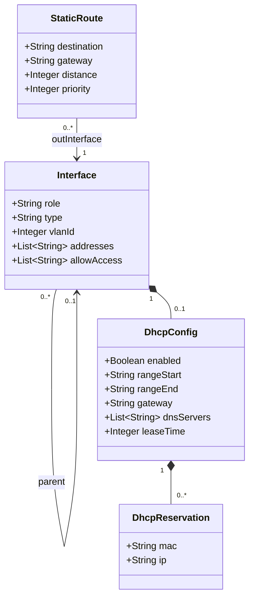
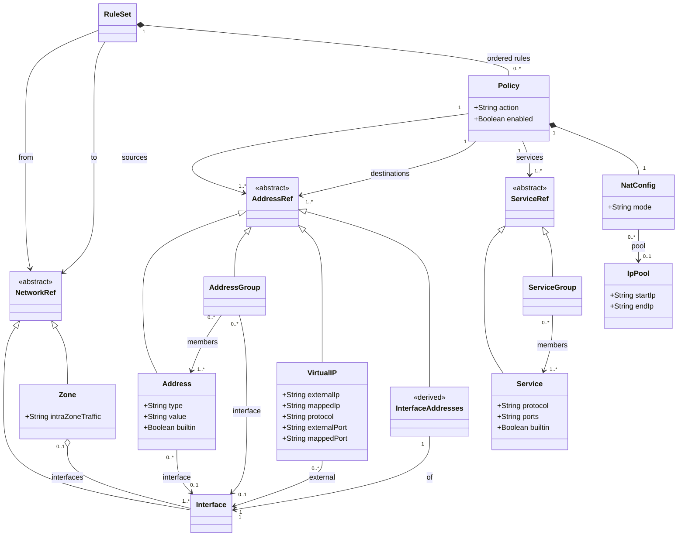
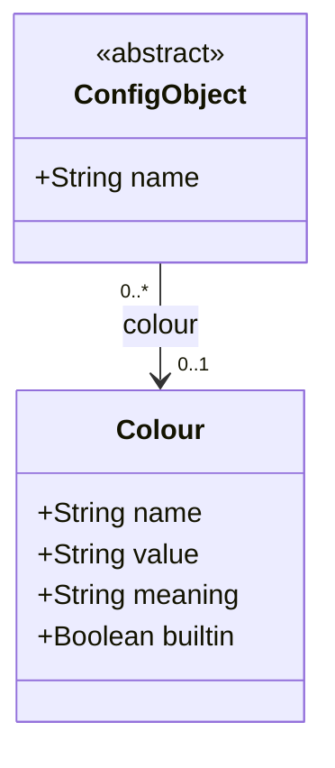

# Domain Model — Songbird

| | |
|---|---|
| Version | 0.5-draft |
| Aligned with | Requirements Analysis v2.0.1-draft (with the changes listed in [Impact on the RA](#impact-on-the-ra)) |

Conceptual model of the firewall's **configuration objects**. It describes what exists, how it is connected, and which constraints always hold. It contains no technical details (eBPF, netlink, exact YAML format) and no runtime state (conntrack, leases, sessions).

The YAML schema (JSON Schema/CUE), the Validator rules and the Go structs all derive from this model: if the model changes, all three change.

Constraint identifiers are `DM-NN` (Domain Model), to avoid clashing with the RA constraints `C-NNN`. Like RA identifiers, they are stable and never reused: a removed constraint stays in the list as *Deferred* or *Withdrawn*.

## Scope of this version

The model covers **IPv4 only**. IPv6 and Router Advertisement are deferred (see [Deferred](#deferred)).

## Changes

**0.5** (this version)

- **Zone** is again a set of Interfaces, as in FortiGate and in the RA glossary (R-046). The directed pair that holds the ordered Policies is now a **RuleSet** (`from` → `to`), matching the YAML schema.
- `from` and `to` reference an Interface or a Zone. An Interface that belongs to a Zone is referenced through its Zone, except for traffic between two Interfaces of the same Zone (DM-37, DM-38, DM-39).
- DM-06, DM-07, DM-09, DM-11, DM-12 and DM-36 rewritten for RuleSets.

**0.4**

- Three constraints found while aligning the Data Plane design (`dataplane.md` v3): DM-34 (active services open their ports on the Interface), DM-35 (Virtual IP versus management port), DM-36 (per-Zone Policy limit).
- `fqdn` and `mac` Address types flagged as not yet supported by the Data Plane.
- `allowAccess` follows the **owner rule**: it applies to the addresses of the Interface, like FortiGate (DM-05).

**0.3**

- IPv6 removed for now: DHCPv6 client/server, Router Advertisement, IPv6 addresses and routes (DM-30, DM-31, DM-32 deferred).
- **AddressGroup**: all members belong to the group's Interface, or none of them belong to any (DM-16 tightened).
- **StaticRoute**: `distance` and `priority` added, with a preference rule (DM-23 rewritten).

**0.2**

- **Zone** is a first-class object: a named, directed pair (source Interface, destination Interface), e.g. `LAN-WAN1`. A Policy references one Zone instead of two Interfaces.
- **Policy** `sources`, `destinations` and `services` are lists. `logLevel` removed. `deny` renamed `drop`.
- **AddressGroup** and **ServiceGroup** added, flat (no nesting). **StaticRoute** added.
- **Interface**: physical/VLAN distinction, DHCP reservations by MAC. `allowAccess` reduced to `ping` and `https`.
- **Colour** palette added; every configuration object may reference one Colour.

## Diagrams

The model is split into three diagrams for readability. `Interface` appears in more than one.

### 1. Interfaces, DHCP and routing

### 2. Zones, RuleSets, Policies and the objects they reference

### 3. Common base: name and Colour

`ConfigObject` is extended by: Interface, Zone, RuleSet, Policy, Address, AddressGroup, VirtualIP, Service, ServiceGroup, StaticRoute, IpPool. Their `name` and `colour` are therefore not repeated in the tables below. `InterfaceAddresses` is derived and has no file, so it has no colour. The nested classes (DhcpConfig, DhcpReservation, NatConfig) have neither.

**Legend.** Solid arrow = reference (by name in the YAML). Filled diamond = composition (nested in the YAML). Hollow diamond = aggregation (a Zone groups existing Interfaces). The Policies are composed in their RuleSet: they are nested in its YAML. `<<derived>>` = computed concept with no YAML file of its own.

## Classes

### Interface

| Attribute | Type | Req. | Notes |
|---|---|---|---|
| role | enum (wan, lan, ...) | yes | `lan` enables `dhcp` (DM-24) |
| type | enum (physical, vlan) | yes | |
| parent | ref Interface | for `vlan` | the physical Interface carrying the 802.1Q tag (DM-03) |
| vlanId | integer 1–4094 | for `vlan` | |
| addresses | list of IPv4 address/prefix | yes | primary, secondary and additional subnets |
| allowAccess | list of enum (ping, https) | no | what may be reached on the firewall **through the addresses of this Interface**, whatever Interface the packet arrives on; default: none (DM-05) |
| dhcp | DhcpConfig | no | only `role: lan` |

### DhcpConfig (composed in Interface)

| Attribute | Type | Req. | Notes |
|---|---|---|---|
| enabled | boolean | yes | allows preconfiguring without activating |
| rangeStart, rangeEnd | IPv4 | yes | |
| gateway | IPv4 | no | default: the Interface IP in the range's subnet |
| dnsServers | list of IPv4 | no | default: the Interface IP, if the DNS forwarder is enabled |
| leaseTime | seconds | no | default to be defined (e.g. 24 h) |
| reservations | list of DhcpReservation | no | static assignment by MAC (R-017.2) |

### DhcpReservation (composed in DhcpConfig)

| Attribute | Type | Req. | Notes |
|---|---|---|---|
| mac | MAC address | yes | unique within the DhcpConfig |
| ip | IPv4 | yes | unique within the DhcpConfig (DM-29) |

### StaticRoute

| Attribute | Type | Req. | Notes |
|---|---|---|---|
| destination | IPv4/prefix | yes | |
| gateway | IPv4 | yes | |
| outInterface | ref Interface | yes | |
| distance | integer 1–255 | no | lower is preferred; default 10 (proposed) |
| priority | integer 1–65535 | no | tie-breaker among routes with the same distance, lower is preferred; default 1 (proposed) |

**Preference rule** (DM-23). Among the routes to the same `destination`, the active one is the route with the lowest `distance`; if several share it, the one with the lowest `priority`. The others are *backup routes*. A route is eligible only while its `outInterface` is up: this is runtime state and is handled by the Observer, not stored in the model.

### Zone

A named **set of Interfaces** treated alike, as in FortiGate (e.g. `internal` = `lan1` + `lan2`). Membership is declared only in the Zone.

| Attribute | Type | Req. | Notes |
|---|---|---|---|
| interfaces | list of ref Interface | yes | at least one; an Interface belongs to at most one Zone (DM-37) |
| intraZoneTraffic | allow / deny | no | verdict between two member Interfaces when no RuleSet exists for that pair; default `deny` (DM-39) |

### RuleSet

The ordered Policies for traffic entering from `from` and leaving through `to`.

| Attribute | Type | Req. | Notes |
|---|---|---|---|
| from | ref Interface or Zone | yes | where the traffic enters |
| to | ref Interface or Zone | yes | where the traffic leaves; must differ from `from` (DM-06) |
| policies | ordered list of Policy | no | position = priority; the first match wins |

A RuleSet is **directed**: `lan1 → wan1` and `wan1 → lan1` are two different RuleSets. In the UI each RuleSet is an expandable section listing its Policies, and Policies never repeat the Interfaces.

Examples:

| `from` → `to` | Allowed? | Why |
|---|---|---|
| `lan1 → wan1` (no Zones) | yes | plain Interfaces |
| `internal → wan1` (`internal` = `lan1` + `lan2`) | yes | Zone to Interface |
| `lan1 → wan1` while `lan1` is in `internal` | **no** | a member is referenced through its Zone (DM-38) |
| `lan1 → lan2`, both in `internal` | yes | intra-zone traffic: the only case where members are used directly (DM-38) |
| `internal → internal` | **no** | `from = to` (DM-06) |

### Policy

| Attribute | Type | Req. | Notes |
|---|---|---|---|
| ruleSet | ref RuleSet | yes | implied by the RuleSet that contains the Policy |
| sources | list of ref (Address, AddressGroup) | yes | non-empty |
| destinations | list of ref (Address, AddressGroup, VirtualIP, InterfaceAddresses) | yes | non-empty |
| services | list of ref (Service, ServiceGroup) | yes | non-empty |
| action | accept / drop | yes | |
| nat | NatConfig | no | default: no NAT |
| enabled | boolean | no | default true |

Position is **not** an attribute: it is the order in the RuleSet's list.

### NatConfig (composed in Policy)

`mode` ∈ none, interface, pool. With `pool`, a reference to an IpPool is mandatory (DM-13).

### IpPool

`startIp`, `endIp`.

### Address (extends AddressRef)

| Attribute | Type | Req. | Notes |
|---|---|---|---|
| type | enum: ip, range, subnet, fqdn, mac | yes | `fqdn` and `mac` are not yet supported by the Data Plane (`dataplane.md` §7.3) |
| value | depends on type | yes | ip: address; range: start-end; subnet: CIDR; fqdn: name; mac: MAC address |
| interface | ref Interface | no | if present, restricts where it can be used (DM-12) |
| builtin | boolean | no | marks predefined objects such as `all` (DM-21) |

### AddressGroup (extends AddressRef)

| Attribute | Type | Req. | Notes |
|---|---|---|---|
| interface | ref Interface | no | must be the Interface of every member, or absent when no member has one (DM-16) |
| members | list of ref Address | yes | non-empty, flat (no nested groups) |

### InterfaceAddresses (derived, extends AddressRef)

Reserved name `<interface> addresses` (e.g. `LAN addresses`), resolved to the subnets in `Interface.addresses`. It has no YAML file: it follows IP changes automatically, and the Compiler recompiles the Policies that use it. It is bound to its Interface like an Address with `interface` set.

### VirtualIP (extends AddressRef)

| Attribute | Type | Req. | Notes |
|---|---|---|---|
| external.interface | ref Interface | yes | Interface the traffic enters from |
| external.ip | IPv4 | yes | |
| mapped.ip | IPv4 | yes | destination IP after translation |
| protocol | tcp / udp | yes | |
| external.port, mapped.port | port or range | yes | |

### Service (extends ServiceRef)

| Attribute | Type | Req. | Notes |
|---|---|---|---|
| protocol | enum (tcp, udp, icmp, any) | yes | |
| ports | port or range | for tcp/udp | forbidden for the other protocols (DM-17) |
| builtin | boolean | no | marks predefined objects such as `ALL`, `HTTP` |

### ServiceGroup (extends ServiceRef)

| Attribute | Type | Req. | Notes |
|---|---|---|---|
| members | list of ref Service | yes | non-empty, flat, **all with the same protocol** (DM-18) |

### Colour

| Attribute | Type | Req. | Notes |
|---|---|---|---|
| name | string | yes | key |
| value | colour (e.g. `#49F527`) | yes | unique among Colours (DM-33) |
| meaning | string | no | user-defined, e.g. "Backup" |
| builtin | boolean | no | predefined palette: `value` is immutable, `meaning` is editable |

## Constraints

### General

| ID | Constraint |
|---|---|
| DM-01 | Names are unique per class. Address, AddressGroup, VirtualIP and InterfaceAddresses share one namespace; Service and ServiceGroup share another, because a Policy references them by name in a single list. Interface and Zone share a third, because `from` and `to` reference either. Policy names are unique within their RuleSet. |
| DM-02 | Every reference points to an existing object (referential integrity). |

### Interfaces

| ID | Constraint |
|---|---|
| DM-03 | `type = vlan` requires `parent` (a `physical` Interface) and `vlanId` ∈ 1–4094; `(parent, vlanId)` is unique. `type = physical` has neither. |
| DM-04 | Interfaces with IPs in overlapping subnets are rejected. |
| DM-05 | `allowAccess` contains only `ping` and `https`, without duplicates. Default: empty. `ping` governs ICMP echo only. It applies to the addresses of the Interface (owner rule), not to the Interface the packet arrives on. |
| DM-34 | A network service enabled on an Interface implicitly accepts its own ports from that Interface, independently of `allowAccess`: the DHCP server (UDP 67) where `dhcp.enabled`, and the DNS server (UDP/TCP 53) on the Interfaces where it listens, once `DnsConfig` is modelled. `allowAccess` governs only management protocols. |

### Zones, RuleSets and Policies

| ID | Constraint |
|---|---|
| DM-06 | A RuleSet's `from` and `to` reference existing Interfaces or Zones and **must differ**. `any` does not exist. A RuleSet from a Zone to the same Zone is not allowed: intra-zone traffic uses Interface-to-Interface RuleSets (DM-38). |
| DM-07 | There is at most one RuleSet per ordered pair `(from, to)`. With DM-37 and DM-38, every ordered pair of distinct Interfaces is governed by at most one RuleSet. |
| DM-37 | A Zone has at least one Interface, and an Interface belongs to at most one Zone. |
| DM-38 | An Interface that belongs to a Zone is referenced in `from` / `to` through its Zone. The only exception is a RuleSet whose `from` and `to` are two different Interfaces of the **same** Zone (intra-zone traffic). |
| DM-39 | For two distinct Interfaces of the same Zone with no RuleSet between them, `intraZoneTraffic` decides: `deny` (default) applies Default Deny, `allow` accepts the traffic. Both produce Flow Events (R-026). |
| DM-08 | `sources`, `destinations` and `services` of a Policy are non-empty. |
| DM-09 | Order matters only within a RuleSet. Traffic between Interfaces governed by no RuleSet, or matching no Policy, is dropped and logged (Default Deny, R-033), except as stated in DM-39. |
| DM-10 | A VirtualIP may appear only in `destinations`. |
| DM-11 | If `destinations` contains a VirtualIP, its `external.interface` is the RuleSet's `from` Interface, or a member of its `from` Zone. |
| DM-12 | An Address, AddressGroup or InterfaceAddresses bound to an Interface is usable as a source only in RuleSets whose `from` is that Interface or a Zone containing it, and as a destination only in RuleSets whose `to` is that Interface or a Zone containing it. |
| DM-13 | With `nat.mode = pool` the reference to an IpPool exists; in the other modes it is absent. |
| DM-35 | If `https` is in `allowAccess` of an Interface, no VirtualIP on that Interface uses an `external.ip` of the Interface with TCP and an `external.port` that includes the management port (443). |
| DM-36 | The number of enabled Policies in a RuleSet does not exceed the per-RuleSet limit of the Data Plane (ADR-0006). The Validator enforces it, so that an Apply never fails on map size. |

### Objects

| ID | Constraint |
|---|---|
| DM-14 | `value` is consistent with `type` (a range has start ≤ end; a subnet is valid CIDR; etc.). |
| DM-15 | An AddressGroup has at least one member, no duplicates, and its members are Addresses only (not VirtualIPs, not derived addresses, not other groups). |
| DM-16 | All members of an AddressGroup belong to the same Interface, or none of them belongs to any. In the first case the group's `interface` is that Interface; in the second it is absent. |
| DM-17 | `ports` is mandatory and valid (1–65535, ordered range) for `tcp` and `udp`, and absent for the other protocols. |
| DM-18 | A ServiceGroup has at least one member, no duplicates, and all members have the same `protocol`. |
| DM-19 | A VirtualIP's `external.ip` belongs to `Interface.addresses` of its external Interface. |
| DM-20 | If `external.port` is a range, `mapped.port` is a range of the same length or a single port. |
| DM-21 | Predefined objects (Address `all`, Service `ALL`, `HTTP`, ...) are YAML files generated at setup with `builtin: true`. The Validator checks they are present and rejects edits and deletions. |

### Routing

| ID | Constraint |
|---|---|
| DM-22 | A StaticRoute's `gateway` lies in a subnet of `outInterface`. |
| DM-23 | Among the StaticRoutes with the same `destination`, the active route is the one with the lowest `distance`, then the lowest `priority`. No two routes share `(destination, distance, priority)`. |

### DHCPv4

| ID | Constraint |
|---|---|
| DM-24 | `dhcp` is allowed only if `role = lan`. |
| DM-25 | `rangeStart ≤ rangeEnd`, both in the same subnet, and that subnet is one of `Interface.addresses`. |
| DM-26 | The range contains neither the Interface IP nor the gateway. |
| DM-27 | The gateway, if specified, lies in the range's subnet. |
| DM-28 | DHCP ranges of different Interfaces do not overlap. |
| DM-29 | A reservation's `ip` lies in the DHCP subnet (inside or outside the dynamic range) and is neither the Interface IP nor the gateway; `mac` and `ip` are unique among the reservations of the Interface. |

### Deferred (IPv6)

| ID | Constraint |
|---|---|
| DM-30 | *Deferred.* Was: `dhcpv6Client` allowed only on `role = wan`. |
| DM-31 | *Deferred.* Was: `dhcpv6Server` and `routerAdvertisement` allowed only on `role = lan`. |
| DM-32 | *Deferred.* Was: a Router Advertisement has exactly one of `prefix` and `delegatedFrom`. |

### Colour

| ID | Constraint |
|---|---|
| DM-33 | Colour `value`s are unique. A `builtin` Colour keeps its `value`; only its `meaning` may change. A configuration object references at most one existing Colour. |

## Design notes

- **`allowAccess` is not a Policy.** It governs traffic *to* the firewall (local-in); Policies govern traffic *through* it. The implicit drop in DM-09 applies only to the latter.
- **Secure by default.** With `allowAccess` empty by default, the setup wizard (R-031) must set `https` (and optionally `ping`) on the LAN Interface, otherwise the UI is unreachable.
- **Intra-interface Policies cannot be expressed** (DM-06: `from ≠ to`). Consequently there is no hairpin NAT in v1: a LAN client reaching a VirtualIP would go from LAN to LAN. Workaround: internal DNS resolving the service to the private IP.
- **Traffic between hosts on the same L2 segment** does not traverse the firewall and cannot be filtered by a Policy.
- **No per-Policy log level.** Every Flow produces an Event (R-026); volume is controlled by rate limiting (R-026.1), not by Policy.
- **Policy identifier.** The "matched Policy identifier" required by R-026 is, for now, the pair (RuleSet name, Policy name). Renaming a Policy changes it.
- **Group Interface is redundant.** Since DM-16 forces it to equal the members' Interface, `AddressGroup.interface` could be derived instead of stored. It is kept explicit for readability of the YAML.

## Deferred

Not modelled for now, and the RA requirements that depend on them:

| Topic | RA requirements affected |
|---|---|
| IPv6 forwarding | R-001.3, R-001.4 |
| Router Advertisement / SLAAC, NDP | R-004, R-005 |
| DHCPv6 and Prefix Delegation | R-017.4 |
| NAT64 / DNS64 | R-006, R-006.1, R-006.2, R-018.6 |
| IPv6 addressing and routes | R-012 (IPv6 examples), R-020.4 |

## Impact on the RA

Changes needed in the RA (proposed v2.0.2) for the model and the requirements to be consistent:

| Where | Change |
|---|---|
| Glossary: Zone | **No change**: a named set of Interfaces, an Interface in at most one Zone. |
| Glossary: RuleSet (new) | The ordered Policies for one directed pair (`from`, `to`) of Interfaces or Zones; one RuleSet per pair. |
| R-014, R-014.x | The incoming and outgoing Interface or Zone are fields of the RuleSet; the Policy inherits them. |
| R-046 | Keep. Add: an Interface that belongs to a Zone is referenced through it, except for traffic between two members of the same Zone (DM-38). |
| Open issue #4 | Resolved: no `any`; `from ≠ to`; one RuleSet per pair. |
| Glossary: Address Group, Service Group; R-011, R-013 | Groups are flat: remove nesting and cycle rejection. Address Group: all members on the same Interface, or none. Service Group: single protocol. |
| R-012 | Add the `fqdn` and `mac` Address types, or remove them from the model. |
| New requirement | Administrative access to the firewall (ping, HTTPS) configurable per Interface, default none. Check consistency with R-038 and R-031. |
| R-001, R-020.4 | State the StaticRoute fields: destination, gateway, outgoing Interface, distance, priority, and the backup-route behaviour. |
| R-017.2 | Already Must; the model implements it (DHCP reservations by MAC). |
| IPv6 requirements | See [Deferred](#deferred): decide whether to lower their priority or schedule them for a later milestone. |
| New requirements | IpPool / NAT with pool (suggested Could); Policy `enabled` flag; explicit exclusion (W) of intra-interface Policies and hairpin NAT. |
| Glossary: Action | Use `drop`, consistent with the model. |

## Open questions

- **Routes with the same destination, distance and priority**: rejected for now (DM-23). Allow them as equal-cost multipath instead? The dataplane would need to balance Flows across gateways.
- **Defaults** for `distance` (10) and `priority` (1) are proposed, not decided.
- **`ip` Address type**: equivalent to a /32 subnet. How is it represented in the YAML?
- **DnsConfig**: model of the DNS forwarder/recursor (R-018) still to be defined.
- **Still to model**: User and Role (R-043), Repository (R-021), notifications (R-030), TLS/ACME (R-038), HA (R-023).
