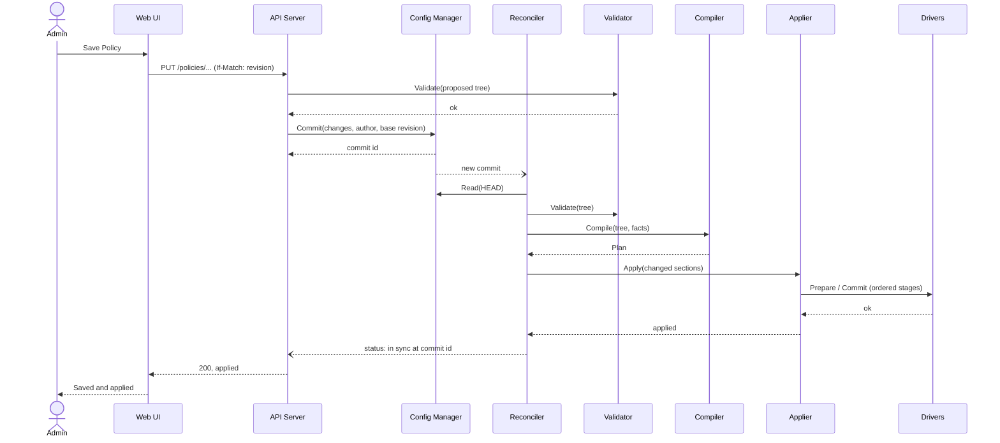
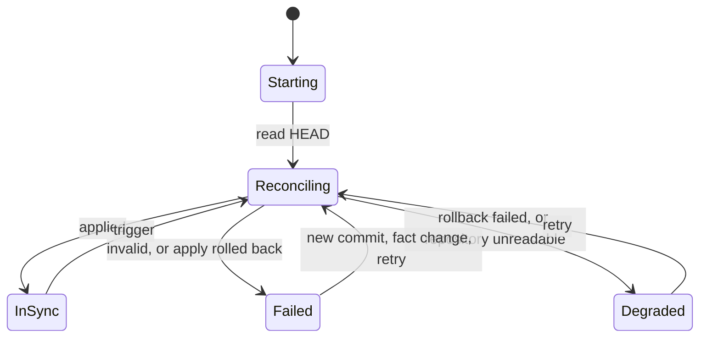

# Reconciliation Loop — Songbird

| | |
|---|---|
| Version | 0.1-draft |
| Status | Draft for team review |
| Inputs | Requirements Analysis v2.0.1-draft, `domain-model.md` v0.4, `components.md` v0.1, `dataplane.md` v3, ADR-0001, ADR-0008 |
| Requirements | R-019, R-020.2, R-020.3, R-020.6, R-021, R-023.4, R-030, R-032, R-033.1 |

The reconciliation loop is the central concept of the Control Plane. It is the pattern of Kubernetes controllers: the **desired state** is declared (YAML in Git, ADR-0001), a controller continuously drives the **actual state** of the system towards it, and reports what it sees.

```
desired state (HEAD) → validate → compile → apply (atomic) → observe → status
        ↑                                                            │
        └──────────────── trigger: commit, boot, fact change, retry ─┘
```

The loop is **level-triggered**: it never applies "the change that just happened", it always computes the difference between the latest desired state and what is applied. Missed or duplicated triggers are therefore harmless, and rollback, crash recovery and HA all reduce to "reconcile again" (§10).

## 1. Components involved

| Component | Role in the loop |
|---|---|
| Config Manager | Holds the desired state (`HEAD`), notifies new commits |
| Reconciler | Owns the loop: decides when to run, tracks desired vs applied, reports status |
| Validator | Checks the tree (pure) |
| Compiler | Produces the `Plan` (pure) |
| Applier | Executes one apply as a transaction across drivers |
| Drivers (Dataplane, Network, DHCP, DNS) | `Snapshot`, `Prepare`, `Commit`, `Rollback` on their subsystem |
| Observer | Aggregates status of the drivers and of the Reconciler |

See `components.md` for interfaces and dependency rules.

## 2. State the loop works with

| State | Where it lives | Persistent? |
|---|---|---|
| **Desired** | Git `HEAD` of the local repository | Yes (configuration) |
| **Runtime facts** | Kernel, read by the Network Driver: Interface presence, link state, current addresses, ifindexes | No |
| **Applied** | Per driver: commit id and hash of the applied `Plan` section. For the Data Plane, the generation header (`dataplane.md` §8) | No, rebuilt from the drivers |
| **Last known good** | Commit id of the last configuration applied successfully | Yes, as **runtime state** outside Git (not configuration) |

`Plan` sections carry a content hash, so the loop can tell which drivers are affected by a commit and skip the others.

## 3. Triggers

| Trigger | Source | Notes |
|---|---|---|
| New commit | Config Manager subscription | UI or CLI change, revert, pull from remote (R-040, R-023.4), schema migration (ADR-0008) |
| Start | Control Plane start (boot or crash restart) | R-033.1 |
| Runtime fact change | Network Driver (netlink events) | An Interface appears or disappears; an Interface address changes, which changes `InterfaceAddresses` |
| Retry timer | Reconciler | After a transient failure (§7) |
| Periodic resync | Reconciler timer, proposed every 5 min | Drift detection (§8) |

Triggers are **coalesced**: they only set a "dirty" flag. One reconciliation runs at a time, always on the latest `HEAD` and the latest facts. A reconciliation in progress is never interrupted: it completes or rolls back, then the next one starts if the flag is set.

## 4. Steps

| # | Step | Owner | Input | Output | On error |
|---|---|---|---|---|---|
| 1 | **Read** | Reconciler → Config Manager | `HEAD` | Configuration tree, commit id | Repository unreadable → state *Degraded*, running state untouched, alert |
| 2 | **Validate** | Validator | Tree | List of errors (file, path, reason, R-020.3) | Not applied (R-020.2); state *Failed*; errors shown in status and UI |
| 3 | **Compile** | Compiler | Tree, runtime facts | `Plan` with one hashed section per driver | Should not happen after validation: treated as a bug, state *Failed* |
| 4 | **Diff** | Reconciler | `Plan`, applied state | Set of sections to apply | Empty set → only record the commit as applied (e.g. a Colour changed) |
| 5 | **Apply** | Applier → drivers | Sections to apply | Applied, or rolled back with reason | Rolled back → *Failed*; rollback failed → *Degraded* (§6) |
| 6 | **Observe** | Drivers → Observer | — | Per-driver status, read-back check | Mismatch → treated as drift (§8) |
| 7 | **Status** | Reconciler | Results of 1–6 | `ReconcilerStatus`, `/health`, Audit Log entry, alert if needed | — |

Validation also runs in the API before a commit (`components.md`), so step 2 normally fails only for changes that did not go through the API: a pull, a manual edit of the repository, a migration.

## 5. Sequence: a change from the UI



The API returns only when the reconciliation of its commit has finished (with a timeout), so the administrator sees **"saved and applied"** or **"saved, not applied: reason"**, with an action to revert.

## 6. Atomic apply across drivers (R-020.6)

### 6.1 What each driver can guarantee

| Driver | Prepare | Commit | Rollback | Atomic? |
|---|---|---|---|---|
| **Dataplane** | Build and verify the inactive generation | Switch `active_gen` (one write) | Switch back | **Yes**, instantaneous |
| **Network** (netlink) | Snapshot kernel state; compute the list of operations; check feasibility (parent NIC exists, no conflicts) | Execute operations in dependency order | Execute the inverse operations from the snapshot | No: a short sequence of operations |
| **DHCP** | Render and check the configuration | Swap configuration, keep leases | Restore the previous configuration | Yes for the service, if the engine supports reload |
| **DNS** | Render and check the configuration | Swap configuration, flush cache if needed | Restore the previous configuration | Yes for the service, if the engine supports reload |

### 6.2 Order

The Data Plane needs the Interfaces created by the Network Driver (it resolves names to ifindexes in `Prepare`), and Interfaces must not be removed while the Data Plane still refers to them. The Applier therefore runs:

1. **Pre-flight**: `Prepare` for every driver whose preparation does not depend on earlier commits (Network operations list, DHCP, DNS). Any rejection stops the apply **before anything changes**.
2. **Network, additive part**: create Interfaces and VLANs, add addresses and routes.
3. **Dataplane**: `Prepare` (now that ifindexes exist), then `Commit` (generation switch).
4. **DHCP and DNS**: `Commit`.
5. **Network, removals**: delete routes, addresses, Interfaces that are no longer configured.

If any step fails, the Applier rolls back the steps already committed, **in reverse order**, and reports the first error.

### 6.3 Fail-closed intermediate states

The Data Plane switch is the single point where the Policies change, and it is atomic: traffic sees either the old or the new Policies, never a mix. Network changes before the switch only **add** Interfaces, which no RuleSet references yet and are therefore denied (`dataplane.md` §7.1). Removals happen after the switch. Intermediate states therefore never permit more than the old or the new configuration.

Known limitation: when an Interface **address** changes, the window between step 2 and step 3 can see the new address with the old Policies (for example `InterfaceAddresses` still resolved to the old subnet). The window is milliseconds and biased towards denying; it is accepted for now.

### 6.4 When rollback fails

If a rollback operation fails, the system is in neither the old nor the new state. The Reconciler sets *Degraded*, raises an alert (R-030), and schedules a reconciliation **of the last known good commit** with retry. The Data Plane is not affected (its rollback is a single write), so filtering stays coherent while networking is repaired.

## 7. Failures and retries

| Kind | Examples | Behaviour |
|---|---|---|
| **Invalid configuration** | Validation error after a pull | *Failed*; no retry; wait for a new commit |
| **Deterministic apply error** | Configured NIC is missing; address rejected by the kernel | Rolled back; *Failed*; no retry until a new commit **or** a relevant fact change (the NIC appears) |
| **Transient apply error** | netlink `EBUSY`, service reload timeout | Rolled back; *Failed*; retry with exponential backoff (1 s, 2 s, 4 s … max 60 s) |

The Git history is **not** changed automatically after a failure: `HEAD` stays the desired state, and the status shows *desired ≠ applied*. Reverting is the administrator's decision (a revert commit through the UI, which then reconciles normally). Automatic rewriting would hide what was asked.

At **start**, if `HEAD` cannot be applied, the Reconciler applies the **last known good** commit (reading its tree from Git, without creating a commit), then reports *Failed* for `HEAD`. This is what R-033.1 requires: the last valid running configuration is restored without manual intervention.

## 8. Observe and drift

**Read-back.** After `Commit`, each driver reads back the state it is responsible for and compares it with its section of the `Plan`.

**Periodic resync.** Every 5 minutes (proposed) the Reconciler compares the drivers' `Snapshot` with the applied `Plan`:

| Subsystem | Drift is possible because | Proposed behaviour |
|---|---|---|
| Data Plane | Only root can modify pinned maps | Compare generation header; mismatch → re-apply, alert |
| Network | Another process or a root shell changes links, addresses or routes | Re-apply for **managed** objects only; event in the Traffic/system log; alert if it recurs (e.g. 3 times in 1 h) |
| DHCP, DNS | Process crash, configuration changed underneath | Restart or reload; status *degraded* until healthy |

Drift correction depends on the open decision "who owns network configuration: Songbird or the OS" (candidate ADR). This document assumes Songbird owns every Interface present in the configuration.

**Runtime facts are not drift.** A link going down is a fact: the kernel's routing and the static route preference (`distance`, `priority`, DM-23) take care of it. The Network Driver sets the sysctls so that routes on a down link are ignored and backup routes take over (to be verified on the reference kernel). An Interface address change is a trigger (§3), because it changes the compiled `Plan`.

## 9. State machine and status



`ReconcilerStatus`:

| Field | Meaning |
|---|---|
| `state` | `starting`, `reconciling`, `in-sync`, `failed`, `degraded` |
| `desiredCommit` | `HEAD` |
| `appliedCommit` | What is running (may be the last known good) |
| `lastAttempt` | Time, commit, result |
| `lastError` | Step, driver, message; validation errors with file and path |
| `drivers` | Per-driver status and applied section hash |

Mapping to `/health` (R-032): `in-sync` → *running*; `reconciling` → *running*; `failed` and `degraded` → *degraded*. The UI shows a banner while `desiredCommit ≠ appliedCommit`. Every apply result is written to the Audit Log (who committed, what was applied, success or failure), and `failed` / `degraded` raise alerts (R-030).

## 10. What the loop solves by itself

| Concern | How |
|---|---|
| **Rollback** | A revert is a new commit; the loop applies it like any other |
| **Crash recovery** (R-033.1) | Control Plane restart: the Dataplane Driver reads the generation header; if the applied commit equals `HEAD`, nothing is done and traffic never stopped. Reboot: everything is rebuilt from `HEAD`, or from the last known good if `HEAD` fails |
| **HA** (R-023.4) | Each node pulls from the shared branch (GitOps Sync); the pull is a new commit; each node reconciles on its own. No configuration is exchanged between nodes. The 60 s target depends on the pull interval |
| **Updates** (R-019, ADR-0008) | After an update, the schema migration is a commit; the update is confirmed only when the loop reaches `in-sync` and the Observer reports healthy |
| **Atomic apply** (R-020.6) | Ordered stages with rollback (§6) |

## 11. Timing budget for R-033.1

From Control Plane start to restored forwarding: **30 s**. Proposed budget, to be measured on the reference platform (ADR-0007):

| Phase | Budget |
|---|---|
| Process start, reattach to pinned maps | 2 s |
| Schema check / migration (ADR-0008) | 3 s |
| Read, validate, compile | 5 s |
| Apply (network, dataplane, services) | 10 s |
| Margin | 10 s |

After a reboot, OS boot time comes first and is not under Songbird's control; the requirement should state from which moment the 30 s are counted.

## 12. Verification

| Test | Method | Covers |
|---|---|---|
| Reconciler with a fake Applier: coalescing, retry and backoff, fallback to last known good, no-op when nothing changed | `T-U` | §3, §7 |
| Applier with fake drivers: order of stages, rollback in reverse order, failure at each stage | `T-U` | §6 |
| Configuration whose last block cannot be applied: Data Plane and kernel state equal the snapshot taken before | `T-I` | R-020.6 |
| `kill -9` of the Control Plane during traffic: no packet loss, applied commit detected | `T-S` | R-033.1 |
| Reboot: forwarding restored within the budget | `T-S` | R-033.1 |
| Route deleted by hand: restored at the next resync, event emitted | `T-I` | §8 |
| Pull of a commit with a validation error: not applied, status shows file and path | `T-S` | R-020.2, R-020.3 |

## 13. Open questions

1. **Resync interval** and the threshold for alerting on recurring drift.
2. **DHCP leases**: proposed as persistent runtime state of the DHCP Service, outside Git, so clients keep their addresses across reboots. Closes the point left open in ADR-0001.
3. **API wait**: how long the API waits for the reconciliation before answering "saved, apply in progress".
4. **Ownership of unmanaged Interfaces** (present in the kernel, absent from the configuration): ignore, or bring down? Linked to the candidate ADR on network ownership.
5. **R-033.1 wording**: from which moment the 30 s are counted after a reboot.
6. **Network rollback guarantees**: which netlink operations are not reversible in practice (e.g. removing a VLAN drops its state) and need special handling.
